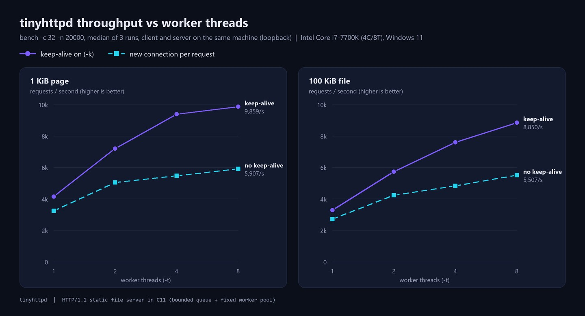

# Benchmarks



## Setup

| | |
|---|---|
| CPU | Intel Core i7-7700K @ 4.20 GHz, **4 cores / 8 threads** |
| OS | Windows 11 (build 26100), loopback `127.0.0.1` |
| Compiler | GCC 16.2 (MinGW-w64 UCRT, POSIX threads), `-O2`, static link |
| Server | `server -q -t <1,2,4,8>`, defaults otherwise: queue 64, keep-alive 5 s, max 100 requests/connection |
| Load | `bench -c 32 -n 20000 [-k]`: 32 closed-loop clients (each sends its next request only after the previous response arrives) |
| Files | `small.html` = 1 024 bytes, `large.html` = 102 400 bytes |
| Method | 1 warm-up run of 2 000 requests, then 3 measured runs per configuration; the table shows the **median** run by requests/sec. Spread between the 3 runs was within about 5 %, except w=4 / 100 KiB / keep-alive (7.6k to 8.4k). |

Client and server share the same 4-core machine, so above 4 workers they compete for CPU.

## Results

| file | keep-alive | workers | req/s | MB/s | p50 ms | p90 ms | p99 ms | max ms | errors |
|---|---|---:|---:|---:|---:|---:|---:|---:|---:|
| 1 KiB | off | 1 | 3 237 | 3.3 | 9.51 | 11.10 | 13.82 | 18.9 | 0 |
| 1 KiB | off | 2 | 5 043 | 5.2 | 5.98 | 7.30 | 9.73 | 12.8 | 0 |
| 1 KiB | off | 4 | 5 472 | 5.6 | 5.45 | 6.88 | 9.20 | 14.4 | 0 |
| 1 KiB | off | 8 | 5 907 | 6.0 | 5.08 | 6.06 | 7.22 | 9.1 | 0 |
| 1 KiB | **on** | 1 | 4 137 | 4.2 | 0.23 | 0.28 | 345.25 | 770.6 | 0 |
| 1 KiB | **on** | 2 | 7 201 | 7.4 | 0.27 | 0.32 | 186.32 | 428.5 | 0 |
| 1 KiB | **on** | 4 | 9 387 | 9.6 | 0.41 | 0.54 | 137.19 | 311.4 | 0 |
| 1 KiB | **on** | 8 | **9 859** | 10.1 | 0.79 | 0.95 | 95.89 | 280.2 | 0 |
| 100 KiB | off | 1 | 2 710 | 277.6 | 11.49 | 12.82 | 15.95 | 21.1 | 0 |
| 100 KiB | off | 2 | 4 236 | 433.8 | 7.29 | 8.45 | 10.50 | 19.4 | 0 |
| 100 KiB | off | 4 | 4 828 | 494.4 | 6.28 | 7.62 | 9.32 | 12.5 | 0 |
| 100 KiB | off | 8 | 5 507 | 563.9 | 5.39 | 6.64 | 8.68 | 21.0 | 0 |
| 100 KiB | **on** | 1 | 3 281 | 336.0 | 0.29 | 0.36 | 440.86 | 989.8 | 0 |
| 100 KiB | **on** | 2 | 5 733 | 587.0 | 0.33 | 0.43 | 236.07 | 563.8 | 0 |
| 100 KiB | **on** | 4 | 7 602 | 778.5 | 0.50 | 0.66 | 164.02 | 382.5 | 0 |
| 100 KiB | **on** | 8 | **8 850** | **906.2** | 0.88 | 1.13 | 108.39 | 288.0 | 0 |

"errors" counts failed plus non-2xx responses. Across all 48 measured runs plus warm-ups
(about one million requests) there were **zero** errors and zero 503s.

## What the numbers say

**1. Keep-alive throughput follows `workers / per-request time` until the CPU runs out.**
With keep-alive a worker serves one connection at a time, request after request. At one
worker, p50 latency is 0.23 ms, so the ceiling is 1 / 0.23 ms ≈ 4 300 req/s; we measured
4 137. Going from 1 to 2 workers gives ×1.74 and from 2 to 4 gives ×1.30. From 4 to 8 it
is only ×1.05, because there are only 4 physical cores and the 32 `bench` threads run on
the same CPU. Per-request time rises (p50 0.23 → 0.79 ms) as the cores saturate. These are
diminishing returns: past the core count, more threads add contention, not capacity.

**2. Keep-alive's p99 shows the cost of pinning a worker to a connection.** The median
keep-alive request takes under 1 ms, but p99 is 96–441 ms. With 32 clients and *w*
workers, only *w* connections are being served; the other clients have sent their request
and are waiting in the queue. A served connection only frees its worker after `-m 100`
requests. The worst wait is therefore roughly `(32/w − 1) × 100 × per-request time`. For
w=1 that is 31 × 100 × 0.23 ms ≈ 710 ms (measured max: 771 ms). For w=8 it is
3 × 100 × 0.79 ms ≈ 240 ms (measured: 280 ms). The model and the measurements agree,
which shows the tail is a scheduling effect and not slow code. A larger `-m` would raise
throughput a little and make the tail worse. The real fix is an event loop that parks
idle connections and gives workers only sockets that already have a request waiting.

**3. Without keep-alive, connection setup dominates and scaling stops at about 2 workers.**
Every request pays for a TCP handshake, `accept()` on the single main thread, and a
teardown in the Windows TCP stack. Throughput goes from 3.2k to 5.0k, then flattens
(5.5k, 5.9k). Latency follows Little's law: 32 in-flight clients / 5 907 req/s ≈ 5.4 ms,
against a measured p50 of 5.1 ms. The tails are tight (p99 within 2× of p50) because the
queue hands out work fairly: every connection is one request.

**4. Keep-alive is worth +21 % to +72 % throughput** at the same worker count (1 KiB:
4.1k vs 3.2k at w=1, 9.9k vs 5.9k at w=8), and it cuts median latency by about 10×.
For real browsers, which open a few connections and reuse them, this is the mode that
matters.

**5. Body size barely matters on loopback.** The 100 KiB file reaches 80–90 % of the
1 KiB request rate and moves up to **906 MB/s**. Each response is streamed from disk in
64 KiB chunks (two `send()` calls for 100 KiB) with no whole-file buffering. The cost
is in per-request work (syscalls, parsing, context switches), not in copying bytes.

### Caveats

- **Loopback is not a network.** There is no NIC, no packet loss and microsecond RTTs, which
  favours connection-heavy workloads and hides bandwidth limits.
- **Client and server share 4 cores.** At 8 workers part of what we measure is CPU contention
  with `bench` itself.
- **Windows specifics:** TCP connection setup on Windows loopback is comparatively expensive,
  which hurts the no-keep-alive rows. The first open of each file can be slowed by
  antivirus scanning (visible as a ~6–18 ms first request in the access log; the warm-up
  hides it here). The same code on Linux would likely show different, probably higher,
  no-keep-alive numbers; that has not been measured.
- `bench` is a closed-loop generator: it measures how fast 32 well-behaved clients are
  served, not the maximum request rate an open-loop flood could push.
- These numbers describe this design on this machine. They are not a comparison with
  production servers such as nginx, which use event loops, `sendfile`, and years of tuning.

## Reproduce

```powershell
mingw32-make                                   # or: make (Linux/macOS)
python -E -P scripts/run_benchmarks.py --reps 3 --requests 20000
python -E -P scripts/plot_bench.py --machine "Intel Core i7-7700K (4C/8T), Windows 11"
```

`run_benchmarks.py` creates `build/bench-www/` with the two test files and then, for each
configuration, runs exactly:

```powershell
build\server.exe -q -p 0 -t <1|2|4|8> -d build\bench-www          # port printed on startup
build\bench.exe -c 32 -n 2000  [-k] http://127.0.0.1:<port>/<small.html|large.html>   # warm-up
build\bench.exe -c 32 -n 20000 [-k] http://127.0.0.1:<port>/<small.html|large.html>   # x3, median kept
```

The server is stopped with Ctrl-Break (graceful shutdown) between configurations. Raw
results, including every run's full `bench` output, are in
[`benchmarks/results.json`](benchmarks/results.json).
