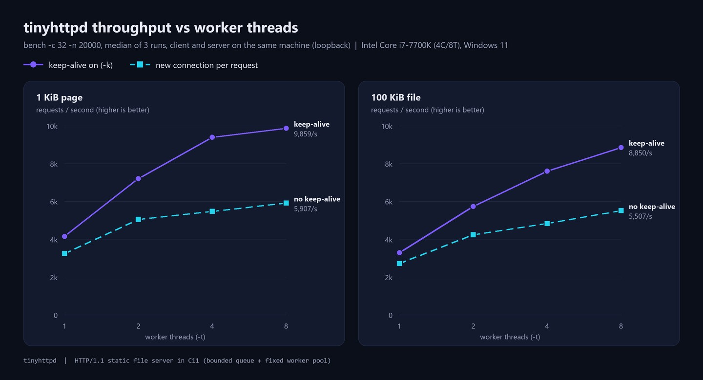

# tinyhttpd

A small **multithreaded HTTP/1.1 static-file web server written from scratch in C11**, with
its own load-testing client, unit tests, an end-to-end test suite and measured benchmarks.
It builds and runs on **Windows (Winsock2 + MinGW-w64)** and **Linux/macOS (POSIX sockets)**
from the same source, behind a thin compatibility layer.

```
$ ./build/server.exe -p 8080 -d ./www -t 4
tinyhttpd listening on http://127.0.0.1:8080/ (docroot ./www, 4 workers, queue 64, keep-alive 5s, max 100 req/conn)
press Ctrl-C to stop
127.0.0.1 - - [24/Nov/2026:01:28:05 +0000] "GET /__stats HTTP/1.1" 200 151 0.04ms
127.0.0.1 - - [24/Nov/2026:01:28:05 +0000] "GET / HTTP/1.1" 304 0 0.28ms
127.0.0.1 - - [24/Nov/2026:01:28:05 +0000] "GET /%2e%2e/%2e%2e/windows/win.ini HTTP/1.1" 403 14 0.07ms
```

## Why I built it

It follows on from my earlier Java **CmdServer**, a multithreaded TCP command server with
a fixed thread pool of 3 and a line-based telnet protocol. This project rebuilds the same
idea one level lower, with nothing between me and the OS:

| Learning goal | Where it shows up |
|---|---|
| **Sockets**: what `ExecutorService` and `ServerSocket` hide | `net.c`: `getaddrinfo`, `bind`/`listen`/`accept`, timeouts, half-close, RST avoidance, Winsock vs BSD differences |
| **Concurrency**: correct locking with no garbage collector to lean on | `queue.c`: ring buffer + mutex + two condition variables; `stats.c`: C11 atomics; coordinated shutdown |
| **Protocol parsing**: a real, strict wire format | `http.c`: request line, headers, limits, keep-alive rules, dates |
| **Security**: what a file server must refuse | `fileserve.c`: traversal, encoded dots, backslashes, NUL bytes, Windows device names |

The Java server's `Executors.newFixedThreadPool(3)` became an explicit **bounded queue +
configurable pool** with a defined overload policy (503), and its telnet text protocol
became HTTP/1.1 with persistent connections.

## Features

- **HTTP/1.1 and HTTP/1.0**: `GET` and `HEAD`; persistent connections (keep-alive) with an
  idle timeout and a max-requests-per-connection limit; `Connection: close`; pipelined
  requests; absolute-form targets.
- **Strict parser** with explicit limits: `400` malformed, `405` + `Allow: GET, HEAD`,
  `408` too slow, `414` URI > 2048 bytes, `431` headers > 8 KiB or > 64 fields,
  `505` HTTP/2+, `400` for a missing `Host` in 1.1, obs-fold, whitespace before `:`, bare CR
  and request bodies.
- **Static files**: MIME table by extension, `index.html` for directories, `301` to add the
  trailing slash, `Last-Modified` / `If-Modified-Since` → `304`, files streamed in 64 KiB
  chunks (never loaded into memory whole), header and first chunk combined into one `send()`.
- **Built-in endpoints**: `GET /__health` → `ok`; `GET /__stats` → JSON
  (`uptime_s`, `requests_total`, `by_status`, `active_connections`, `queue_depth`, `workers`, ...).
- **Access log** in Common Log Format plus latency; lines are serialized with a mutex; `-q` silences it.
- **Graceful shutdown** on Ctrl-C / SIGINT / SIGTERM: stop accepting, drain the queue, join
  the workers, print stats.
- **`bench`**: a closed-loop load generator with N threads, optional keep-alive, and exact
  latency percentiles (min/avg/p50/p90/p99/max).

## Architecture

```
                 ┌────────────────────────────── server.c ───────────────────────────────┐
  clients ──TCP──► main thread: accept() loop                                            │
                 │      │                                                                 │
                 │      ▼ queue_try_push()                    full? ──► 503 + close       │
                 │  ┌──────────────────────────────┐          (back-pressure)             │
                 │  │ bounded ring buffer (queue.c)│  mutex + not_empty / not_full CVs    │
                 │  └──────────────┬───────────────┘                                      │
                 │                 ▼ queue_pop()                                          │
                 │  ┌────────┐ ┌────────┐ ┌────────┐ ┌────────┐   fixed pool of N workers  │
                 │  │worker 1│ │worker 2│ │worker 3│ │worker 4│   (-t, default 4)          │
                 │  └───┬────┘ └────────┘ └────────┘ └────────┘                            │
                 └──────┼──────────────────────────────────────────────────────────────────┘
                        ▼ conn.c: keep-alive loop
            read until "\r\n\r\n" ─► http.c parser ─► router ─┬─► /__health, /__stats (stats.c)
                                                              └─► fileserve.c: decode ─► sanitise
                                                                   ─► stat ─► 304 / stream file
                        ▲                                            │
                        └────────── next request (keep-alive) ◄──────┘    log.c: access log
```

| File | Responsibility |
|---|---|
| `src/net.c/h` | socket compat layer: init/cleanup, `closesocket` vs `close`, error codes, timeouts, `SO_EXCLUSIVEADDRUSE` vs `SO_REUSEADDR`, `select` vs `poll`, `MSG_NOSIGNAL`, lingering close |
| `src/platform.c/h` | monotonic clock (`QueryPerformanceCounter` / `clock_gettime`), `gmtime_s`/`gmtime_r`, 64-bit `stat`, Ctrl-C (`SetConsoleCtrlHandler` / `sigaction`) |
| `src/queue.c/h` | bounded blocking queue of accepted connections |
| `src/http.c/h` | request parser, percent-decoder, IMF-fixdate format/parse, reason phrases (pure, no I/O) |
| `src/conn.c/h` | per-connection loop: deadlines, framing errors, routing, keep-alive, pipelining |
| `src/fileserve.c/h` | path sanitiser and static file handler |
| `src/response.c/h` | response heads and small complete responses |
| `src/mime.c/h`, `src/stats.c/h`, `src/log.c/h` | MIME table, atomic counters, serialized access log |
| `src/server.c` | CLI, accept loop, worker pool, shutdown |
| `src/bench.c` | load generator |

Every `#ifdef _WIN32` lives in `net.c` or `platform.c`; the rest of the code only sees an
integer `sock_t` and portable functions.

### Request lifecycle

1. **Accept.** The main thread waits on the listening socket with a 250 ms `select`/`poll`
   timeout (so it can notice shutdown), `accept()`s, sets `TCP_NODELAY` and a send timeout,
   and calls `queue_try_push()`. If the queue is full it answers `503 Retry-After: 1` itself and
   closes the socket.
2. **Dispatch.** A worker blocked in `queue_pop()` wakes on `not_empty` and takes the connection.
3. **Read.** `conn.c` reads into a fixed 8 KiB buffer until it finds the blank line that
   ends the headers. A request must arrive within 10 s of its first byte (`408`); between
   requests the keep-alive idle timeout (`-k`) applies. A full buffer with no blank line
   is `431`, or `414` if no line break has been seen at all.
4. **Parse.** `http_parse_request()` makes one validating pass and returns `0` or the status to send.
5. **Route.** `/__health` and `/__stats` are handled inline. Everything else goes to
   `fs_serve()`: percent-decode, sanitise, join to the docroot, `stat`, redirect or index,
   `If-Modified-Since`, then stream.
6. **Log + count.** One access-log line, plus atomic counters.
7. **Loop or close.** With keep-alive, any pipelined bytes are moved to the front of the buffer
   and the loop continues. Otherwise the socket is closed. After errors or unread input it
   first half-closes and drains, so the client is not sent a RST before it has read our response.

## Concurrency design

**Why a bounded queue with a fixed pool instead of a thread per connection?** One thread
per connection lets memory and scheduler load grow with the number of clients, so a burst
or a slowloris attack can exhaust the machine. A fixed pool caps the threads, and a
bounded queue caps the backlog. Together they give the server a known, constant footprint.

**Back-pressure.** Once all workers are busy and the queue holds `-Q` connections, the
next client gets an immediate `503` instead of an unbounded wait. Failing fast tells
load balancers and clients to back off, and it keeps the latency of already-accepted work
under control. The queue also has a blocking `queue_push()` (waits on `not_full`), which the
unit tests use, so both condition variables are exercised.

**The queue** (`src/queue.c`) is a textbook monitor: one mutex guards `head`/`count`;
consumers wait on `not_empty`, producers on `not_full`; every wait sits in a `while` loop
because of spurious wake-ups; push signals one consumer and pop signals one producer.

**Shutdown is coordinated, not abrupt.** The signal / console handler only stores to an
atomic flag, which is async-signal-safe. The accept loop sees the flag within 250 ms and
closes the listener. `queue_close()` broadcasts on both condition variables. Workers finish
their current request; idle keep-alive connections are dropped within one 200 ms poll
slice; queued connections are still served. `queue_pop()` returns 0 only when the queue is
closed and empty. Main then joins every worker and prints the stats.

**Statistics** are lock-free C11 atomics. A `/__stats` snapshot is not one atomic instant,
which is the normal trade-off for metrics.

**Known trade-off: keep-alive pins a worker.** While a client keeps its connection open,
its worker waits for that client's next request. With more keep-alive clients than
workers, the extra clients wait in the queue until a connection closes or reaches `-m`
requests. This is the main finding in [BENCHMARKS.md](BENCHMARKS.md). The real fix is an
event loop (epoll/kqueue/IOCP) that parks idle connections and only hands *readable*
sockets to workers, and that is the next step for this design.

## Security measures

- **Path traversal**: the path is percent-decoded *first*, then split into segments; any
  `..` segment is refused with `403`, so `/../`, `%2e%2e/`, `%2E%2E%2F` and `..%5c` all fail.
  Paths are never resolved with `..`, so there is no "normalize then check" gap.
- **Characters that mean something to the OS**: backslash (a path separator on Windows), `:`
  (drive letters, NTFS `::$DATA` streams), wildcards `* ? < > | "`, control characters, and
  segments ending in `.` or space (Windows strips those silently). All are `403`.
- **Windows device names** (`CON`, `NUL`, `AUX`, `PRN`, `COM1-9`, `LPT1-9`, `CONIN$`), with any
  extension and in any directory, are refused on every platform. On Windows, `/con` would
  otherwise open the console.
- **NUL bytes**: `%00` is rejected by the decoder, so a C string cannot be cut short.
- **Dotfiles** (`.git`, `.env`, ...) are not served. There are no directory listings.
- **Header injection**: only visible ASCII is accepted in the target, and control
  characters in header values are rejected, so neither the `Location` header nor the
  access log can be split.
- **Request smuggling surface**: whitespace before `:`, obs-fold, duplicate `Host` /
  `Content-Length`, and any request body are rejected, and every error closes the connection.
- **Resource limits**: fixed 8 KiB header buffer, 2 KiB URI, 64 headers, 10 s request
  deadline, idle timeout, send timeout, bounded queue and pool. There is no per-request `malloc`.
- **Safe defaults**: binds to `127.0.0.1` unless `-b 0.0.0.0` is given. On Windows it uses
  `SO_EXCLUSIVEADDRUSE` so another process cannot hijack the port.

## Build, run, test

Requirements: a C11 compiler with pthreads (GCC or Clang), GNU make, and Python 3.11+ for
the integration tests. On Windows use MinGW-w64 with POSIX threads (WinLibs or MSYS2 UCRT64);
`winpthreads` provides `<pthread.h>`.

**Linux / macOS**

```sh
make                # build/server, build/bench, build/tests  (-std=c11 -Wall -Wextra -Wpedantic -O2)
make test           # unit tests
make integration    # end-to-end tests against the real binary
make test-asan      # AddressSanitizer + UBSan build, unit + integration tests (Linux/macOS only)
make cppcheck       # static analysis
./build/server -p 8080 -d ./www -t 4
```

**Windows (PowerShell, MinGW-w64 on PATH)**

```powershell
mingw32-make            # build\server.exe, build\bench.exe, build\tests.exe (statically linked)
mingw32-make test
mingw32-make integration
.\build\server.exe -p 8080 -d .\www -t 4
```

> **ASan on Windows:** MinGW-w64 GCC does not ship a usable AddressSanitizer runtime, so
> `make debug` / `make test-asan` only run on Linux/macOS (CI does this).
> **Toolchain in a path with spaces?** Some MinGW builds pass the path of
> `default-manifest.o` to the linker unquoted. Point `GCC_EXEC_PREFIX` at the 8.3 short path
> of `<mingw64>\lib\gcc\` to work around it.

Use `WERROR=1` to make warnings fatal (CI does). The build has **zero warnings** with GCC 16,
and `cppcheck --enable=all` reports nothing.

**Server options**

```
-p <port>     port (default 8080, 0 = any free port)      -t <n>   worker threads (default 4)
-b <addr>     bind address (default 127.0.0.1)            -k <s>   keep-alive idle timeout (default 5, 0 = off)
-d <dir>      document root (default ./www)               -m <n>   max requests per connection (default 100)
-Q <n>        pending-connection queue (default 64)       -q       no access log
```

**Load tester**

```sh
./build/bench -c 32 -n 20000 -k http://127.0.0.1:8080/index.html
```

**Tests.** `tests/test_main.c` holds 163 checks in 10 groups: the parser (valid, keep-alive
rules, 20+ malformed inputs), the percent-decoder, the path sanitiser, MIME lookup, date
round-trips, and the queue (FIFO/wrap/close semantics plus a 4-producer/4-consumer stress
test that checks every item arrives exactly once). `tests/integration.py` (standard library
only) starts the real server on a free port with a temporary docroot and runs 21 scenarios:
status/body/length/type, HEAD, 404, 301, eleven traversal variants → 403, 405 + Allow, garbage →
400, 431, 414, 304, keep-alive socket reuse, pipelining, HTTP/1.0, idle timeout, `/__stats`,
50 parallel clients, access-log format, 503 back-pressure, and graceful shutdown via
Ctrl-Break/SIGINT.

## Benchmarks

The full table, exact commands and interpretation are in **[BENCHMARKS.md](BENCHMARKS.md)**.
In short (4-core i7-7700K, Windows 11, loopback, 32 concurrent clients):

| 1 KiB page | 1 worker | 2 workers | 4 workers | 8 workers |
|---|---:|---:|---:|---:|
| keep-alive, req/s | 4 137 | 7 201 | 9 387 | **9 859** |
| new connection per request, req/s | 3 237 | 5 043 | 5 472 | 5 907 |

- About **1 million requests with zero errors**. The 100 KiB file is served at up to **906 MB/s**.
- Keep-alive gives +21–72 % throughput and about 10× lower median latency. Scaling follows
  `workers / request time` until the 4 physical cores saturate.
- Keep-alive p99 latency (96–441 ms, against a sub-millisecond median) is the cost of pinning
  one worker per connection. A simple queueing model predicts the measured tail, which is
  why an event loop is the next step for this design.



## Limitations

- **No TLS.** Put it behind a TLS-terminating reverse proxy.
- **GET/HEAD only.** No request bodies: chunked or `Content-Length > 0` is rejected with `400`.
- **No `Range` requests, compression, ETags, directory listings or virtual hosts.**
- **One worker per open connection**, as described above. Thousands of idle keep-alive clients
  need an event loop, not more threads.
- The 503 on overload is written from the accept thread and closed straight away. If the
  client has already sent its request, the close may become a RST.
- Symlinks inside the docroot are followed. On Windows, file names are passed through the
  ANSI code page, so non-ASCII names may not resolve.
- POSIX and CI builds are written to compile on Linux and macOS but were **not run** on this
  Windows machine. See `.github/workflows/ci.yml`.

## License

MIT © Aaron Morris Jara, see [LICENSE](LICENSE).
