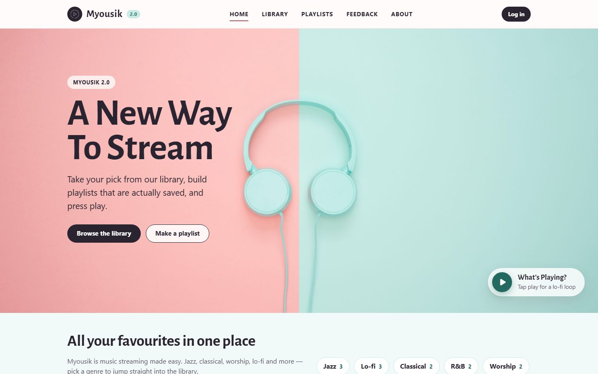
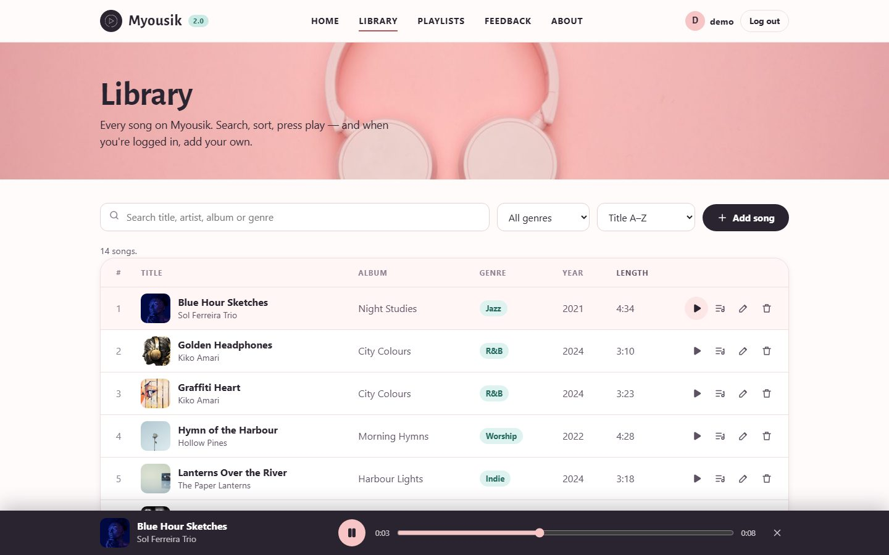
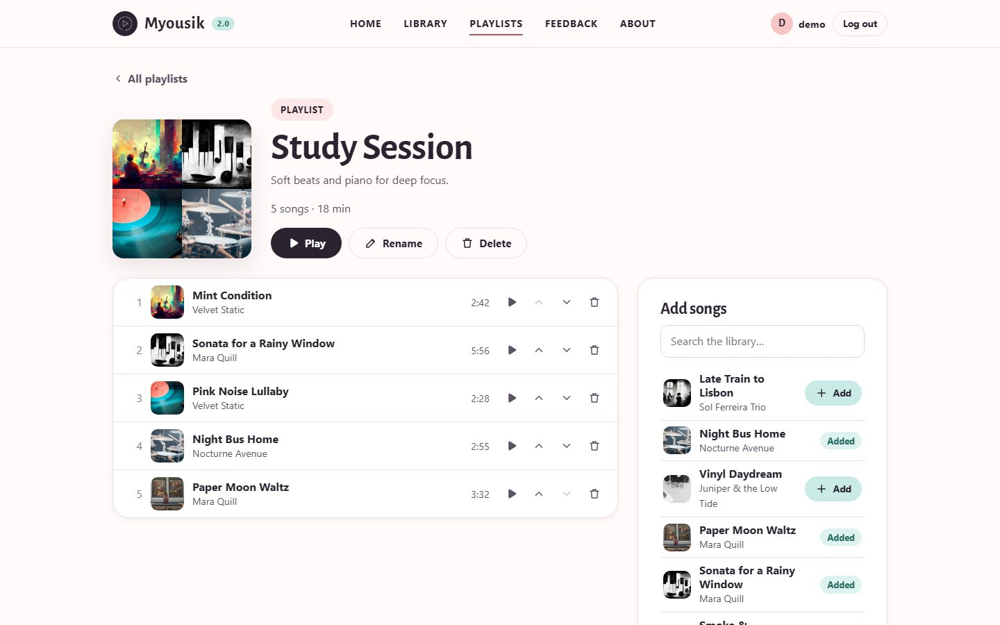
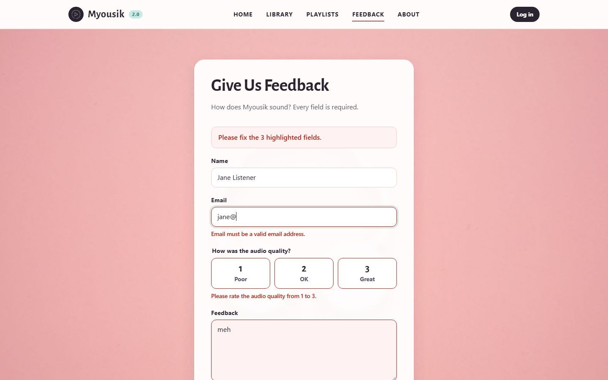
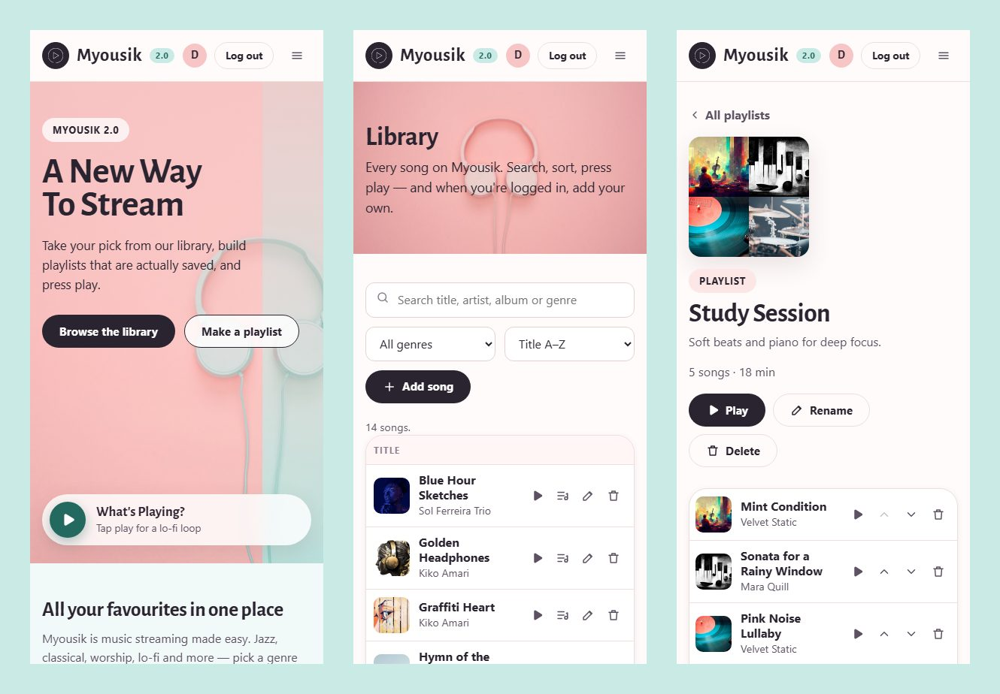

# Myousik 2.0

A full-stack rebuild of **Myousik**, a music-streaming site mockup made by a four-person college team. Version 1 was static HTML with jQuery form checks and "success" pages that saved nothing. Version 2 is a working app: an Express REST API, a SQLite database, real accounts and sessions, a song library you can search and edit, personal playlists you can reorder, and a feedback form that stores what people send.



| Library (logged in, player bar playing) | Playlist view |
| --- | --- |
|  |  |
| **Feedback form validation** | **Mobile (390 px)** |
|  |  |

---

## What changed from v1, and why

| v1 (class project) | v2 (this repo) | Why |
| --- | --- | --- |
| Static pages, `npx http-server` | Express 5 server + JSON API | Pages need real data and real writes |
| No database | SQLite via Node's built-in `node:sqlite`, SQL migrations, seed script | Zero native modules to compile; one file to back up |
| Login form → `loginsent.html` | Register / log in / log out with scrypt-hashed passwords and server-side sessions | Accounts that actually work |
| Feedback form → `feedbacksent.html` | `POST /api/feedback`, validated on the server and stored | Feedback that isn't thrown away |
| Hard-coded song cards and artists | Library with search, sort, pagination and full CRUD; home page reads the API | Content comes from data, not markup |
| — | Personal playlists: create, rename, delete, add/remove songs, reorder | The core "streaming app" feature v1 only implied |
| jQuery 1.4.2 from a dead Microsoft CDN | Plain ES modules, `fetch`, no framework | Nothing to load from a third party; modern browser APIs are enough |
| Desktop-only floats | CSS grid/flex, fluid type, works down to 375 px | Usable on phones |

### v1 bugs fixed

1. **Player script ran before the DOM existed.** `js/playsong.js` was loaded in `<head>`, so `getElementById('icon')` returned `null` and the play button never worked. All v2 scripts are ES modules, which are deferred automatically.
2. **Feedback selector bug.** The validator read `$("input#feed")`, but the feedback field was a `<textarea id="feed">`, so the comments were never checked (and the rating was never checked at all). v2 validates every field, in the browser *and* on the server.
3. **Regex / error-text mismatch.** The password regex required a leading letter, 8–16 more characters and a trailing digit (10–18 in total), while the message said "8 to 16 characters … have a ! or *". v2 has one rule definition (`public/js/shared/validation.js`) imported by both browser and server, and the message describes the rule that is enforced.
4. **Password logged to the console.** The login script did `console.log("Password: " + password)`. v2 never logs credentials and never stores them in plain text.
5. **Dead jQuery CDN.** `ajax.microsoft.com/ajax/jQuery/jquery-1.4.2.min.js` no longer serves a usable script, so every form's validation silently failed. v2 has no jQuery and no third-party scripts at all.

Smaller things also fixed: malformed nav markup (an unclosed `<a>` around the whole nav), `<lable>` typos, mismatched `label for=` attributes, `width: 100` without a unit, a broken `background2.jpg` reference, and student numbers published in the footer.

---

## Features

- **Home**: hero and "What's Playing?" button from v1 (now plays the top pick through the player bar), genre chips, stats, *Top Picks* (songs in the most playlists) and *Popular Artists*, all from the API.
- **Library**: search-as-you-type, genre filter, 8 sort orders, pagination; filters are kept in the URL. Logged-in users can add songs; the user who added a song can edit or delete it (accessible `<dialog>` modals). Any song can be added to one of your playlists.
- **Playlists**: create, rename/describe, delete; open a playlist to play it, move songs up/down, remove them, and search the library to add more. Cover mosaic and total running time.
- **Accounts**: register, log in, log out; `?next=` returns you where you were (same-site paths only).
- **Feedback**: the v1 form (name, email, 1–3 audio rating, comments) with client and server validation; server field errors are shown next to the fields.
- **Player bar**: one shared `<audio>` element with play/pause, seek and time. The demo library plays three short synthesised loops (`scripts/generate-demo-audio.js`); songs can point at any `https://` audio URL.
- **Accessibility**: real `<label>`s, `aria-describedby` + `aria-invalid` on errors, a `role="alert"` summary, focus moved to the first invalid field, skip link, visible focus rings, `prefers-reduced-motion` respected, ARIA tabs on the login page.

---

## Architecture

```
 Browser (public/)                               Node 24 process
 ───────────────────────                         ────────────────────────────────────────────────
 *.html pages                                    server.js ── loads .env, opens DB, listens
   └─ js/pages/<page>.js (ES module)                 │
        ├─ js/layout.js   header/footer/auth         ▼
        ├─ js/player.js   shared <audio> bar     src/app.js (Express 5)
        ├─ js/forms.js    errors → fields          ├─ securityHeaders   CSP, nosniff, frame-deny…
        ├─ js/api.js      fetch → JSON / ApiError  ├─ express.static(public/)  clean URLs (/library)
        └─ js/shared/validation.js ◄───────┐       └─ /api router
                                            │            ├─ csrfGuard       JSON-only writes, Origin check
              same file imported by ────────┘            ├─ express.json    20 kB limit
                                                         ├─ sessionMiddleware  cookie → req.user
     fetch('/api/...')  ─── JSON ───────────────►        ├─ routes/auth.js      register/login/logout/me
     (session cookie: HttpOnly, SameSite=Lax)            ├─ routes/songs.js     CRUD + search/sort/paging
                                                         ├─ routes/playlists.js owner-only CRUD + order
                                                         ├─ routes/feedback.js  public POST, auth GET
                                                         ├─ routes/catalog.js   genres / artists
                                                         └─ errorHandler   { error: { code, message, fields? } }
                                                                   │
                                                                   ▼
                                                   src/db/index.js  node:sqlite DatabaseSync
                                                   migrations/*.sql applied on startup
                                                                   │
                                                                   ▼
                                                           data/myousik.db (SQLite, WAL)
```

### Project layout

```
server.js                 entry point
src/
  app.js                  builds the Express app (used by server.js and the tests)
  config.js               env vars → config object with safe defaults
  errors.js               HttpError + helpers (badRequest, forbidden, …)
  validation.js           wraps the shared rules: check() throws a 400 with field errors
  auth/password.js        scrypt hash/verify, timing-safe compare
  auth/sessions.js        session store (SHA-256 of token in DB)
  db/index.js             open DB, run migrations, transaction()
  db/migrations/001_init.sql
  db/seed.js              demo user, 14 fictional songs, 2 playlists
  middleware/             auth, cookies, security (headers + CSRF), rateLimit, errors
  routes/                 auth, songs, playlists, feedback, catalog
public/                   HTML, CSS, ES modules, images, demo audio, font
scripts/seed.js           npm run seed / seed:reset
scripts/generate-demo-audio.js
test/                     node:test suites + helpers (ephemeral server, in-memory DB)
```

### Data model

```
users                         sessions
─────────────────────         ──────────────────────────────
id            PK              id          PK  (SHA-256 of cookie token)
username      UNIQUE NOCASE   user_id     FK → users.id  ON DELETE CASCADE
password_hash hex scrypt      created_at  ms
password_salt hex 16 bytes    expires_at  ms (indexed)
created_at
   │ 1
   │                 songs
   │ *  ┌───────────────────────────────┐
   ├────┤ id PK                         │
   │    │ title, artist      NOT NULL   │
   │    │ album, genre, year            │
   │    │ duration_sec  CHECK > 0       │
   │    │ cover_url, audio_url          │
   │    │ created_by FK → users (SET NULL)
   │    │ created_at, updated_at        │
   │    └───────────────┬───────────────┘
   │ 1                  │ 1
   │ *                  │ *
 playlists          playlist_songs  (join table)
 ─────────────────  ───────────────────────────────────────────
 id PK              playlist_id  FK → playlists (CASCADE) ┐ composite
 user_id FK (CASCADE) song_id    FK → songs (CASCADE)     ┘ PRIMARY KEY
 name, description  position     0..n-1, indexed with playlist_id
 created_at,        added_at
 updated_at

feedback: id, name, email, rating CHECK (1–3), comments, created_at
schema_migrations: name PK, applied_at
```

The composite primary key stops a song appearing twice in one playlist. Deleting a song removes it from every playlist (`ON DELETE CASCADE`); deleting a user removes their sessions and playlists but keeps the songs they added (`SET NULL`).

---

## API reference

All endpoints are under `/api` and speak JSON. Errors always look like:

```json
{ "error": { "code": "VALIDATION_ERROR", "message": "Some fields are invalid.", "fields": { "title": "Title is required." } } }
```

| Method | Path | Auth | Success | Notes / errors |
| --- | --- | --- | --- | --- |
| GET | `/api/health` | – | 200 | `{ status: "ok" }` |
| POST | `/api/auth/register` | – | 201 `{ user }` + cookie | 400 fields, 409 username taken |
| POST | `/api/auth/login` | – | 200 `{ user }` + cookie | 400, 401 `INVALID_CREDENTIALS`, 429 `RATE_LIMITED` (+ `Retry-After`) |
| POST | `/api/auth/logout` | – | 204, cookie cleared | Deletes the server-side session |
| GET | `/api/auth/me` | ✔ | 200 `{ user }` | 401 if not logged in |
| GET | `/api/songs` | – | 200 `{ data, pagination }` | `?q=` `?genre=` `?sort=title\|artist\|year\|duration_sec\|created_at\|popularity` `?order=asc\|desc` `?page=` `?limit=` (1–100); 400 on bad params |
| GET | `/api/songs/:id` | – | 200 `{ song }` | 404 |
| POST | `/api/songs` | ✔ | 201 `{ song }` + `Location` | 400 fields, 401 |
| PUT | `/api/songs/:id` | owner | 200 `{ song }` | Full replace (missing optional fields → null); 400, 401, 403, 404 |
| PATCH | `/api/songs/:id` | owner | 200 `{ song }` | Partial update; 400, 401, 403, 404 |
| DELETE | `/api/songs/:id` | owner | 204 | Also removed from playlists; 401, 403, 404 |
| GET | `/api/genres` | – | 200 `{ data }` | Genres with song counts |
| GET | `/api/artists` | – | 200 `{ data }` | Artists with song counts, a cover and playlist popularity |
| GET | `/api/playlists` | ✔ | 200 `{ data }` | Only your playlists, with `song_count`, `total_duration_sec` |
| POST | `/api/playlists` | ✔ | 201 `{ playlist }` | 400 |
| GET | `/api/playlists/:id` | owner | 200 `{ playlist }` with ordered `songs` | 403 not yours, 404 |
| PATCH | `/api/playlists/:id` | owner | 200 `{ playlist }` | Rename / description |
| DELETE | `/api/playlists/:id` | owner | 204 | |
| POST | `/api/playlists/:id/songs` | owner | 201 `{ playlist }` | `{ song_id }` appended at the end; 404 unknown song, 409 duplicate |
| DELETE | `/api/playlists/:id/songs/:songId` | owner | 200 `{ playlist }` | Positions re-packed to 0..n-1 |
| PUT | `/api/playlists/:id/songs/order` | owner | 200 `{ playlist }` | `{ song_ids: [...] }` must be an exact permutation of the current songs, else 400 |
| POST | `/api/feedback` | – | 201 `{ feedback }` | 400 fields; 429 after 20/hour per IP |
| GET | `/api/feedback` | ✔ | 200 `{ data }` | Latest 100 |

Other status codes used everywhere: **415** if a write isn't `Content-Type: application/json`, **403 `CSRF_REJECTED`** for a cross-origin write, **400 `INVALID_JSON`**, **413** for bodies over 20 kB, JSON **404** for unknown API routes.

---

## Running it

Requires **Node 22.13+** (built and tested on Node 24.14).

```bash
npm install
cp .env.example .env        # optional — every setting has a dev default
npm run seed                # demo library + "demo" account (password: DEMO_PASSWORD, default myousik-demo-1)
npm start                   # http://127.0.0.1:3000
```

- `npm run dev` restarts on file changes (`node --watch`).
- `npm run seed:reset` wipes the database and re-seeds it.
- `node scripts/generate-demo-audio.js` regenerates the demo WAV loops.
- Use a different port or database file with `PORT=5601 DB_PATH=data/other.db npm start`.

### Docker

```bash
docker compose up --build   # http://localhost:3000, data in the "myousik-data" volume
```

The image is `node:24-alpine`, runs as the unprivileged `node` user, installs production dependencies only, and has a health check on `/api/health`. Compose seeds the demo library the first time the database is empty.

### Tests

```bash
npm test
```

`node:test` + built-in `fetch`. Each suite starts the real app on an ephemeral port (`listen(0)`) with a fresh **in-memory** SQLite database, so tests are isolated and leave nothing on disk. **37 tests** cover: register / login / logout / `me`, salted hashes and hashed session ids, expired sessions, rate limiting, 415 / CSRF / invalid-JSON handling, security headers, validation errors with per-field messages, song CRUD (PUT vs PATCH), search / sort / pagination, SQL-injection and wildcard input, 401 for anonymous writes, 403 for other users' songs and playlists, playlist add / duplicate / reorder / remove / cascade, and feedback validation and rate limiting.

### About the `ExperimentalWarning`

`node:sqlite` still prints `ExperimentalWarning: SQLite is an experimental feature` on Node 22–24. The API used here (`DatabaseSync`, `prepare`, `run/get/all`) has been stable in practice; the npm scripts and Dockerfile pass `--disable-warning=ExperimentalWarning` to keep logs clean. Running `node server.js` directly just shows the warning once. If the API ever changes, `src/db/index.js` is the only file that touches the driver directly (the routes use `prepare/get/all/run`, which `better-sqlite3` also provides).

---

## Security notes

- **Passwords**: `crypto.scrypt` (N=2¹⁴, r=8, p=1, 64-byte key) with a random 16-byte salt per user; compared with `crypto.timingSafeEqual`. Logins for unknown usernames still run scrypt against a dummy hash, so timing doesn't reveal which usernames exist, and the error message is identical either way.
- **Sessions**: a random 256-bit token in an `HttpOnly; SameSite=Lax` cookie (`Secure` in production). The database stores only the token's SHA-256, so a leaked DB can't be replayed. Sessions expire (7 days by default), are deleted on logout (instant revocation), rotated on login, and swept hourly.
- **CSRF**: `SameSite=Lax` stops the cookie being sent on cross-site POST/PUT/PATCH/DELETE. On top of that, every state-changing request must be `Content-Type: application/json` (an HTML form can't send that, and a cross-site `fetch` with it needs a CORS preflight the server never grants), and any `Origin` header must match the `Host`. No CORS headers are sent at all.
- **Authorisation**: writes need a session (401). Songs can only be changed by the user who added them; playlists can only be read or changed by their owner (403).
- **Injection**: all SQL uses bound parameters. The only dynamic SQL fragments (ORDER BY column, UPDATE column list) come from hard-coded whitelists. LIKE wildcards in search input are escaped.
- **XSS**: the front end builds DOM with `textContent` (the `h()` helper in `public/js/dom.js`), never `innerHTML` with user data. A strict Content-Security-Policy (`script-src 'self'`, no inline scripts or styles) is the second line of defence. URL fields accept only `http(s)://` or site-relative paths, so `javascript:` URLs are rejected.
- **Headers**: CSP, `X-Content-Type-Options: nosniff`, `X-Frame-Options: DENY` + `frame-ancestors 'none'`, `Referrer-Policy`, `Cross-Origin-Opener-Policy`, `Permissions-Policy`, HSTS when cookies are `Secure`; `X-Powered-By` removed; API responses are `Cache-Control: no-store`. Written by hand instead of using helmet so each header is visible and explainable.
- **Rate limiting**: failed logins are limited per IP+username (5 per 15 min) and per IP (50 per 15 min); feedback is limited per IP. The limiter is in-memory, which is right for one process; multiple instances would need a shared store such as Redis.
- **Open redirects**: `?next=` after login only accepts same-site paths (`/…`, not `//…`).
- **Secrets**: none in the repo. Configuration comes from environment variables (`.env.example` documents them); `.env` and `*.db` are git-ignored. The demo password is a development fixture, not a secret.

---

## Design decisions

- **Dependencies: just `express`.** Cookie parsing, security headers, rate limiting, validation and `.env` loading are each 20–80 lines here, and writing them keeps every behaviour explainable in an interview. `process.loadEnvFile` replaces dotenv, `node:sqlite` replaces a native driver, and `node:test` replaces Jest/Mocha.
- **Validation without zod.** zod would be a fine choice, but the rules here are simple and the hand-written validator (~100 lines) runs unchanged in the browser via a plain ES module import, with no bundler. That shared module is what fixes v1's message/rule mismatch for good.
- **Synchronous SQLite.** `DatabaseSync` keeps handlers short and makes transactions trivial (`BEGIN IMMEDIATE … COMMIT`). For a single-process app with millisecond queries this is fine; a high-traffic service would use an async driver or a database server.
- **Reorder by full permutation.** `PUT …/songs/order` sends the whole new order and rewrites positions 0..n-1 in one transaction. It's simpler to reason about than "move item X to index Y", and it rejects stale or tampered orders instead of guessing.
- **Song ownership.** The brief only required a login to write; restricting edits to the song's creator stops one user vandalising another's entries. Seeded songs belong to the `demo` account.

## Known limitations

- No password reset, email verification or account deletion UI.
- Songs are metadata plus a URL; there's no file upload or streaming server.
- The rate limiter and session sweep are per process (fine for one container).
- Playlists are private; there's no sharing or public profile.
- Up/down buttons rather than drag-and-drop for reordering (the API already supports any order).

## Credits

- **v1** built by Medi Muamba, Caio Q, Aaron Jara and Chidinma Etumni; **v2** full-stack rebuild by Aaron Jara.
- Artwork (hero, banner, logo and cover images) carried over from the v1 project, resized for the web.
- Headings use **Alegreya Sans Bold** by Huerta Tipográfica, SIL Open Font License 1.1 (shipped from the v1 project).
- All artists, songs and albums in the demo data are fictional. Demo audio is synthesised by `scripts/generate-demo-audio.js`.

## License

MIT © Aaron Morris Jara — see [LICENSE](LICENSE).
