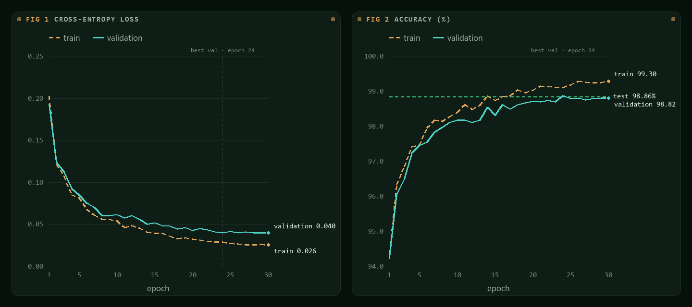
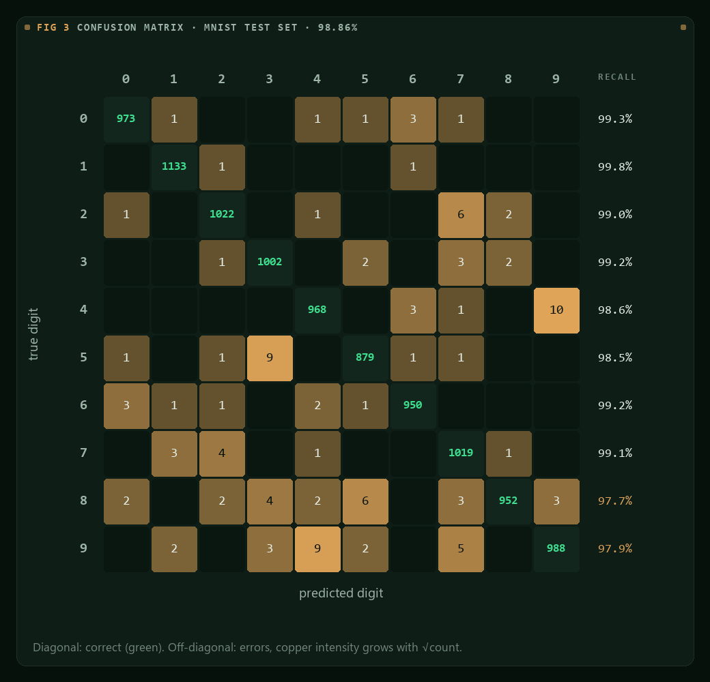
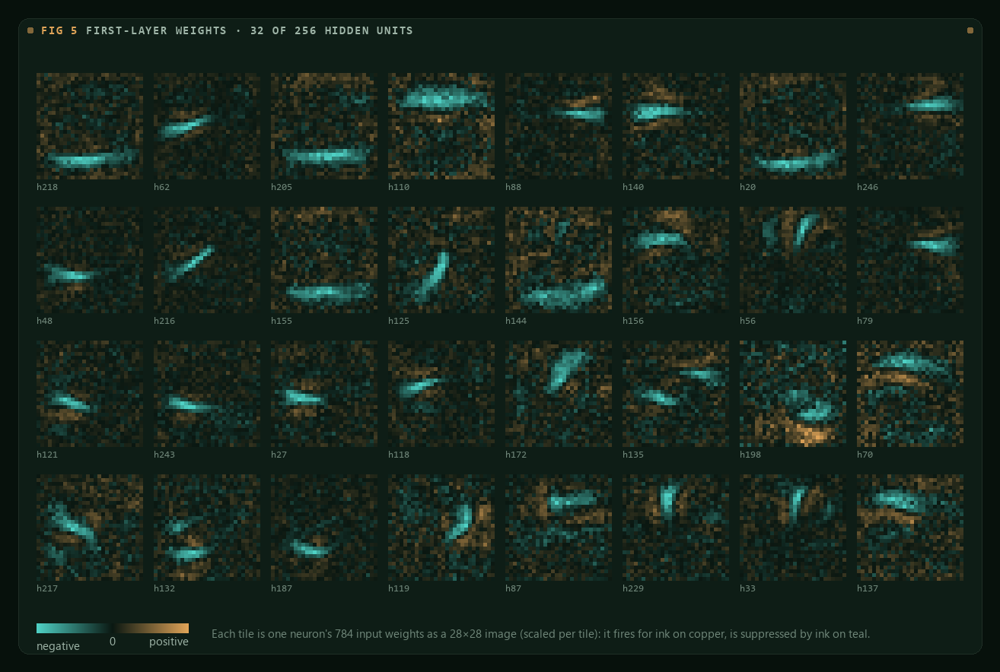
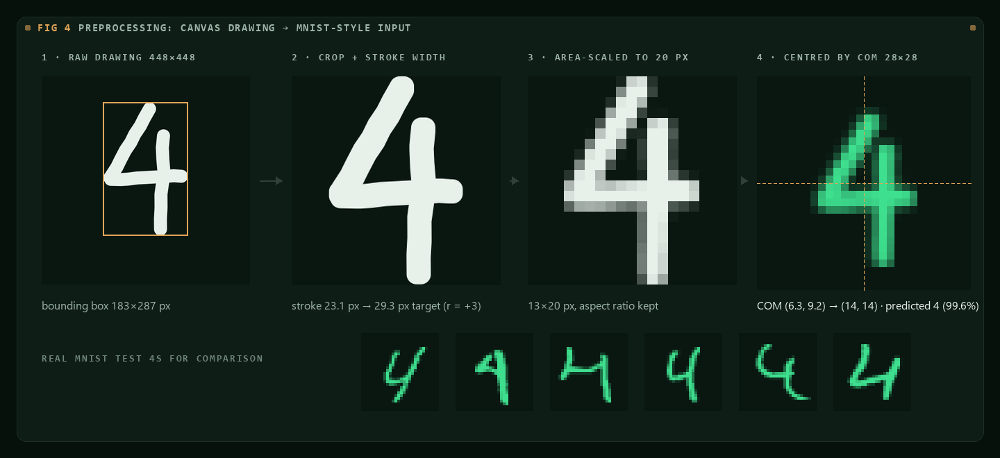

# Neural network from scratch — MNIST digit recognizer

A neural network written from first principles in plain JavaScript: no TensorFlow, no ONNX, no NumPy and no dependencies of any kind. It trains on the 60 000 MNIST handwritten digits in Node, reaches **98.86 % test accuracy**, ships to the browser as a **232 KB int8 model** and runs in a page where you draw a digit and watch the network think.

**[Live demo →](https://aaron367123.github.io/demos/digit-recognizer/)** draw a digit, or press *Try a test image* to cycle through real MNIST test digits (some of which the network gets wrong).

| | |
|---|---|
| Model | MLP 784 → 256 → 128 → 10, ReLU, dropout 0.2 · **235 146 parameters** |
| Test accuracy | **98.86 %** fp32 · **98.86 %** int8 (shipped) · 98.86 % fp16 |
| Training | 30 epochs, AdamW + cosine schedule, augmentation · **≈11 min** on one CPU core (Node 24) |
| Model size | 919 KB fp32 → 460 KB fp16 → **232 KB int8** (+ 1.5 KB JSON manifest) |
| Inference | 0.11 ms per digit in Node (batch 1), forward pass only |
| Tests | 43 `node --test` tests, including finite-difference gradient checks (tolerance 1e-4, worst observed 1e-8) |

## Why from scratch?

Calling `model.fit()` proves you can use a library. Writing the matrix kernels, the backward pass for every layer, the optimiser, the quantiser and the preprocessing yourself proves you know what the library does — and every bug becomes a lesson about the maths. Each piece here is small enough to read in one sitting and is tested against an independent reference: matmul against the textbook triple loop, every gradient against finite differences, Adam against hand-computed numbers.

The same source (`src/`) runs in Node for training and, byte-for-byte, in the browser for the demo.

## Architecture

```
  28×28 image, pixels in [0, 1]
          │  flatten
          ▼
  x ∈ ℝ⁷⁸⁴ ─ Dense 784×256 ─ ReLU ─ Dropout 0.2      200 960 params   (input standardisation (x−μ)/σ fused in)
          ▼
  h₁ ∈ ℝ²⁵⁶ ─ Dense 256×128 ─ ReLU ─ Dropout 0.2      32 896 params
          ▼
  h₂ ∈ ℝ¹²⁸ ─ Dense 128×10                              1 290 params
          ▼
  z ∈ ℝ¹⁰ ─ softmax ─ p = P(digit | image)    ← trained with cross-entropy against the true label
```

```
src/
  tensor.js      matmul kernels (register-tiled + zero-skipping), bias helpers
  prng.js        mulberry32 PRNG, Box–Muller normals, He / Xavier init
  layers.js      Dense, ReLU, LeakyReLU, Dropout, fused Softmax+CrossEntropy — forward and backward
  network.js     Sequential container: forward, backprop, train step, evaluate, trace (for the demo)
  optim.js       SGD+momentum, Adam/AdamW with bias correction, L2/weight decay, cosine & step schedules
  metrics.js     confusion matrix, per-class accuracy
  serialize.js   f32 / f16 / int8 export to a .bin + JSON manifest, loader (Node and browser)
  idx.js         MNIST IDX file parser
  augment.js     random affine augmentation (rotation, scale, shift) with bilinear sampling
  preprocess.js  canvas drawing → MNIST-style 28×28 (crop, stroke width, area-resample, centre of mass)
node/            Node-only helpers: gzip MNIST loader, a tiny anti-aliased rasteriser for tests
train.js         training script        test/   node --test suites        scripts/  download, bench, figures, demo sync
```

## The maths, in plain language

**Forward pass.** A dense layer is a matrix product plus a bias: for a batch `X` (one example per row), `Y = X·W + b`. ReLU keeps positives and zeroes negatives, `max(0, y)`. The last layer produces 10 scores (logits) `z`, and softmax turns them into probabilities:

    p_j = e^{z_j} / Σ_m e^{z_m}

**Loss.** Cross-entropy is the negative log-probability the network gave to the right answer `c`: `L = −log p_c`. It is 0 for a confident correct answer and grows without bound for a confident wrong one.

**Numerical stability.** `e^{1000}` overflows to `Infinity`, so softmax is computed as `softmax(z − max z)`. The constant cancels, and every exponent is ≤ 0. The loss uses the log-sum-exp form `L = log Σ_m e^{z_m − max} − (z_c − max)`, which never takes `log(0)` (tested with logits of ±10 000).

**Backward pass (backprop).** We need `∂L/∂θ` for every weight. The chain rule lets each layer turn the gradient of its output into the gradient of its input, so we walk the layers in reverse:

* **Softmax + cross-entropy, fused:** `∂L/∂z_j = p_j − y_j` where `y` is the one-hot label: "predicted probability minus truth". Fusing the two avoids building softmax's 10×10 Jacobian and is exactly what makes the gradient so clean. Averaged over a batch of `n`, it is `(p − y)/n`.
* **Dense:** given `G = ∂L/∂Y`: `∂L/∂W = Xᵀ·G`, `∂L/∂b = Σ_rows G`, `∂L/∂X = G·Wᵀ`.
* **ReLU:** passes the gradient where the input was positive and blocks it elsewhere: `∂L/∂x = G ⊙ [x > 0]`.
* **Dropout:** during training, zero each unit with probability 0.2 and scale survivors by 1/0.8; backward multiplies by the same mask. At inference it is the identity.

Every one of these is checked in `test/gradcheck.test.js` against central finite differences, `(L(θ+ε) − L(θ−ε)) / 2ε` with ε = 1e-5 on a Float64 copy of the code path, at a relative error below **1e-4** for every weight, bias and input of several small random networks. The worst error actually observed is about 1e-8.

**Adam.** Plain gradient descent uses one step size for every weight. Adam keeps two running averages per weight, the gradient `m` and the squared gradient `v`, and steps by `m / √v`. Weights with consistently large or noisy gradients take smaller steps, and rarely updated ones take larger steps:

    m ← β₁·m + (1−β₁)·g          v ← β₂·v + (1−β₂)·g²
    m̂ = m / (1−β₁ᵗ)              v̂ = v / (1−β₂ᵗ)        ← bias correction: m, v start at 0
    w ← w − η · m̂ / (√v̂ + ε)  −  η·λ·w                    ← decoupled weight decay (AdamW)

The learning rate `η` warms up linearly over the first epoch, then follows a cosine curve from 1e-3 down to 1e-5.

**A small trick worth explaining in an interview: fused standardisation.** Inputs are standardised with the training-set pixel statistics (μ = 0.1307, σ = 0.3081), but standardised pixels are never zero, while raw MNIST pixels are 81 % zeros that a matmul can skip. So the first layer consumes raw pixels and folds the standardisation into its weights algebraically:

    (x − μ)/σ · W + b  =  (1/σ)·x·W + (b − (μ/σ)·1ᵀW)
    ∂L/∂W = (1/σ)·xᵀG − (μ/σ)·1·(Σ_rows G)

It is mathematically identical (tested to 1e-12 and gradient-checked) and makes the first layer about 2× faster.

## Training

`node train.js` (defaults shown; `--epochs`, `--hidden 256,128`, `--seed`, `--batch`, `--lr`, `--dropout`, `--wd`, `--no-aug`):

* 55 000 training / **5 000 held-out validation** images (seeded split) / 10 000 test images, which are only used once at the end
* mini-batches of 128, AdamW (lr 1e-3, weight decay 0.02), 1 epoch linear warm-up, then cosine decay; 30 epochs
* He-normal init for ReLU layers, Xavier for the output layer
* **augmentation** (my own affine warp, `src/augment.js`): each training image gets a random rotation of ±10°, scaling of ±5 % and shift of ±2 px every epoch, with inverse-mapped bilinear sampling
* the weights from the epoch with the best **validation** accuracy are kept (epoch 24 of 30)

| | |
|---|---|
| Final train accuracy (clean, 10k subset) | 99.30 % |
| Best validation accuracy | 98.88 % (epoch 24) |
| **Test accuracy (fp32)** | **98.86 %** (test loss 0.0335) |
| **Test accuracy (int8, shipped)** | **98.86 %** |
| Weakest digits | **8: 97.74 %**, **9: 97.92 %**, 5: 98.54 % |
| Most common confusions | 4→9 (10), 5→3 (9), 9→4 (9), 2→7 (6), 8→5 (6) |
| Wall time | 10.7–11.4 min across two identical seeded runs, ≈ 21–23 s per epoch, single thread |



Validation loss keeps falling while training accuracy measured *with* augmentation and dropout (97.8 %) stays below clean training accuracy (99.3 %): the regularisation is doing its job, and there is little overfitting.



What the first layer learned: each tile is one hidden neuron's 784 incoming weights drawn as a 28×28 image (the 32 neurons with the largest weights). Copper areas excite the neuron and teal areas inhibit it. Most of these strong neurons are *veto* detectors: ink along one particular stroke (a bottom bar, a diagonal, a top arc) switches them off, with a weaker excitatory surround. Together they work as a bank of position-specific stroke tests:



## Quantisation: 919 KB → 232 KB

The browser download is the weights, so they are stored as **int8 with one scale per neuron**: for each output neuron `j`, `s_j = max_k |W_kj| / 127` and `q_kj = round(W_kj / s_j)`, so every weight is off by at most half a step, `s_j / 2` (tested). A separate scale per neuron stops one neuron with big weights from flattening every other neuron's precision. Biases (0.2 % of parameters) stay float32. The loader dequantises once at load time, so inference runs the same float code.

| Format | Size | Test accuracy |
|---|---|---|
| float32 | 940 584 B | 98.86 % |
| float16 (own IEEE-754 half converter) | 471 080 B | 98.86 % |
| **int8 + per-neuron scales (shipped)** | **237 904 B** | **98.86 %** (drop: 0.00 points, budget < 0.3) |

## Preprocessing: making a drawing look like MNIST

A network only works on inputs that resemble its training data, and MNIST digits were prepared in a specific way: size-normalised into a 20×20 box (aspect ratio kept, anti-aliased) and placed in a 28×28 frame so that the **centre of mass** is at the centre. A canvas drawing is a different size, in a different place, with a different pen. `src/preprocess.js` repeats MNIST's recipe, and the same module runs in the demo and in the tests:

1. **Bounding box** of the ink.
2. **Stroke width**: estimated as `2·area / perimeter` (a stroke of width t and length L has area ≈ tL and outline ≈ 2L), then the ink is dilated or eroded so strokes are as thick relative to the digit as MNIST's (2.04 px at 20 px tall, measured over the training set). A thin stylus and a fat finger end up looking alike.
3. **Area-averaging resample** of the longest side to 20 px. Each output pixel is the mean of the source area it covers, which produces MNIST's soft grey edges.
4. **Centre of mass → (14, 14)** with a sub-pixel bilinear shift (MNIST's measured mean is (14.01, 14.00)).
5. Normalise so the peak ink is 1.0.



Tests verify that the centre of mass lands within ±0.5 px of (14, 14) wherever the digit is drawn, that a 120×60 rectangle becomes 20×10, and that pens from 6 px to 40 px all produce 1.4–3 px strokes.

## Performance notes

All training time goes into three matrix products per layer: `X·W` (forward), `Xᵀ·G` (weight gradient) and `G·Wᵀ` (input gradient). Measured with `npm run bench` (`scripts/bench-matmul.js`) on the real shape, a 128×784 batch times 784×256 weights (51 MFLOP):

| Product (batch 128, 784→256) | Naive i-j-k | This code | Speed-up |
|---|---|---|---|
| Forward `X·W`, dense operand | 87.1 ms (0.59 GFLOP/s) | 21.3 ms tiled (2.41 GFLOP/s) | **4.1×** |
| Forward `X·W`, real MNIST pixels (81 % zeros) | 81.2 ms | 10.3 ms zero-skipping (5.0 GFLOP/s effective) | **7.9×** |
| Weight gradient `Xᵀ·G` | 53.5 ms (explicit transpose + naive) | 16.2 ms strided tile | **3.3×** |
| Input gradient `G·Wᵀ` | 53.5 ms (explicit transpose + naive) | 14.2 ms strided tile | **3.8×** |

(Node 24, single thread; the plain i-k-j loop order alone gives only 1.7×. Full numbers in `docs/bench.json`.)

* **Register tiling.** `gemmTiled()` computes a 4×4 block of the output in 16 local variables, so every value loaded from memory is used four times (2 FLOPs per load instead of 1) and no add waits on the previous one. One strided kernel covers all three products: `Xᵀ·G` and `G·Wᵀ` just use different strides, so a transpose is never materialised.
* **Zero skipping.** Raw MNIST batches are 81 % zeros. When most of the left operand is zero, a row-streaming i-k-j loop that skips zero scalars wins, so `matmul()` counts zeros (cheap: O(MK) against O(MKN)) and dispatches. The break-even, about two-thirds zeros, was measured. This is also why the input standardisation is fused (see above).
* **No allocation in the hot loop.** Layers keep growable scratch buffers, so a training step allocates nothing.
* **Single-digit inference** (the demo's case): row streaming instead of tiling for one-row inputs, and the fused-standardisation bias `1ᵀW` is cached between weight updates. Together they took batch-1 inference from 0.49 ms to ≈ 0.1 ms.
* `worker_threads` were not needed: one epoch takes ≈ 22 s on one core.

## Run it

```bash
npm run download     # MNIST (≈11 MB) from storage.googleapis.com/cvdf-datasets/mnist → data/, size + header checks
npm run train        # ≈11 min → model/ (int8 + fp32 weights, metrics.json, demo samples)
npm test             # all tests (model/data tests skip with a message if absent)
npm run bench        # matmul benchmark → docs/bench.json
npm run figures      # docs/*.png from the real training output (needs Python + Pillow)
npm run sync-demo    # copy src/ and the model into the portfolio's demos/digit-recognizer/
```

Requires Node ≥ 22 and nothing else (no `npm install`: zero dependencies). The demo is static: serve the portfolio folder with any HTTP server (`python -m http.server`) and open `demos/digit-recognizer/`. URL parameters: `?sample=7` preloads test sample 7, and `?theme=light|dark` picks the theme.

## Tests

`npm test` runs 43 tests in 11 files:

* **matmul**: every kernel (tiled, sparse, transposed variants, odd shapes) against the naive triple loop
* **gradient checks**: Dense, ReLU, LeakyReLU, softmax-CE and fused standardisation on tiny random nets, checking weights, biases *and inputs*, all at relative error < 1e-4
* **softmax** stability for logits of ±1000 and ±10 000; the gradient sums to zero
* **Adam** against two hand-computed steps; AdamW decay; SGD momentum; LR schedules
* **learning**: XOR (100 %) and a 3-arm spiral (> 95 %)
* **serialisation** round-trip (exact for f32), fp16 conversion edge cases, the int8 error bound, a corrupt-file check
* **preprocessing**: centre of mass, aspect ratio, stroke width, empty canvas
* **IDX parser** on hand-made buffers (including big-endian int32/float32 and bad headers); **augmentation** geometry
* **trained model**: the shipped int8 and fp32 models re-evaluated on the full test set must match the recorded accuracy (−0.1 % tolerance), and the demo samples' recorded predictions must match
* **demo sync**: `demos/digit-recognizer/engine/` must be byte-identical to `src/`, and the demo's model files to `model/`

## Limitations

* **An MLP, not a CNN.** It treats the image as 784 unrelated numbers and has to learn translation tolerance from augmentation. A small convolutional net reaches about 99.3–99.5 % on MNIST; this one stops at 98.9 %. A Conv2D layer would be the natural next step.
* **MNIST is a narrow distribution:** centred, size-normalised, mostly American handwriting from the 1990s. The preprocessing pipeline closes most of the gap to canvas drawings, but unusual styles (a 7 with a crossbar, a 1 with a long flag, a 4 with a closed top) are rarer in the data and less reliable. 4↔9 and 5↔3 are the classic confusions here too.
* **It always answers.** Softmax outputs a digit even for a scribble or a letter. There is no "not a digit" class, and the confidence is not calibrated for out-of-distribution input.
* Single-threaded CPU training: fine for MNIST, but not a training framework.

## Data

MNIST (LeCun, Cortes & Burges), downloaded from the Google-hosted mirror `https://storage.googleapis.com/cvdf-datasets/mnist/` (fallback `https://ossci-datasets.s3.amazonaws.com/mnist/`). The files are not redistributed here.

## License

MIT © Aaron Morris Jara
