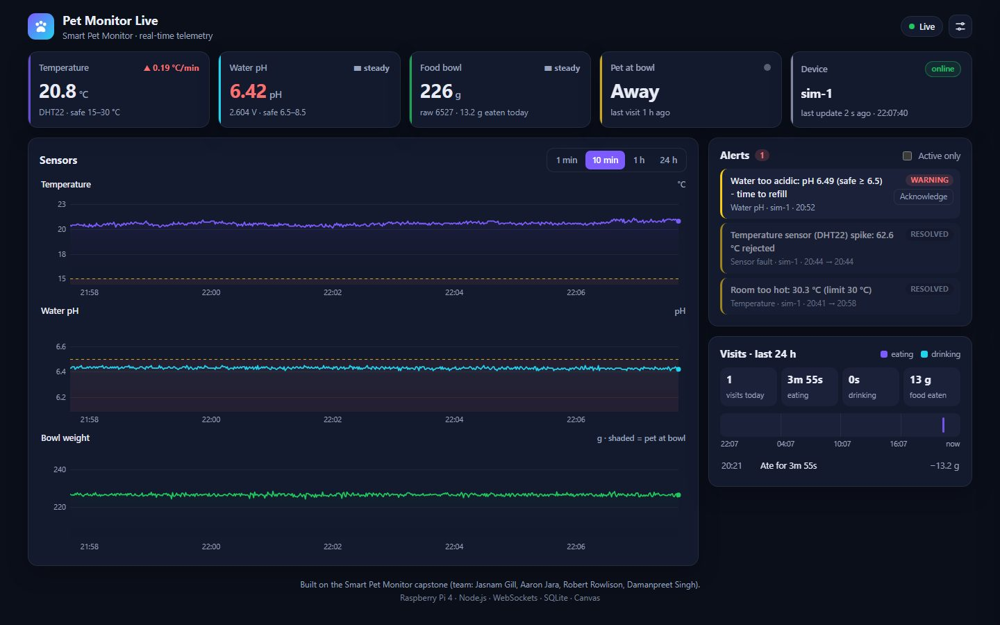
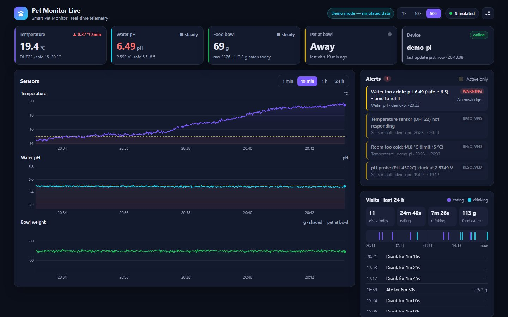
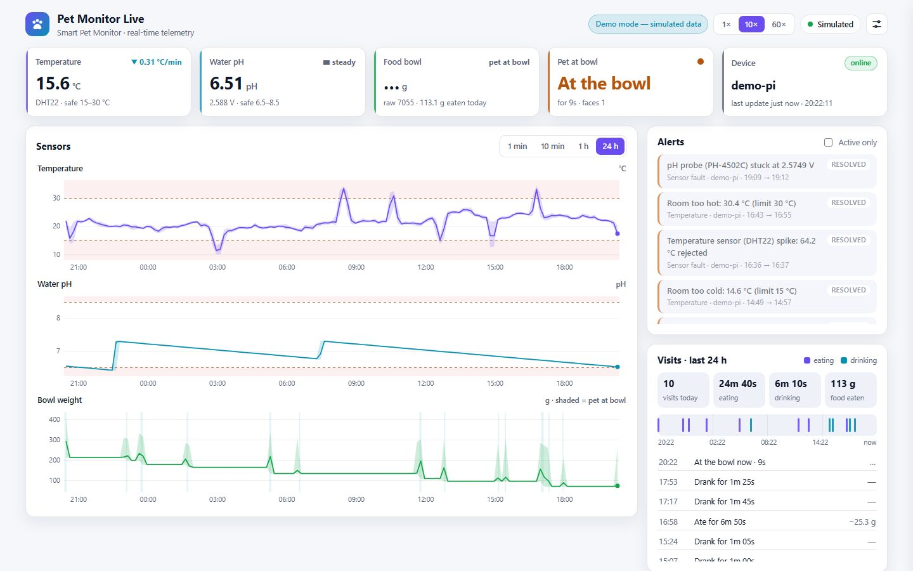
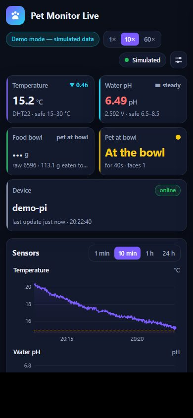

# Pet Monitor Live

A live IoT dashboard for the **Smart Pet Monitor**, a Raspberry Pi pet-bowl station.
Readings are ingested over REST, converted to real units with calibration, turned into
"pet at bowl" visits and alerts, stored in SQLite and streamed to a browser dashboard over WebSockets.

> Built on the Smart Pet Monitor capstone (team: Jasnam Gill, Aaron Jara, Robert Rowlison, Damanpreet Singh).



| Alerts firing (demo, 60×) | 24 h history, light theme | Mobile |
|---|---|---|
|  |  |  |

---

## Problem → what v1 did → what this adds

**Problem.** Owners want to know whether their pet is eating and drinking normally, whether the
water is still clean, and whether the room is too hot or too cold, without standing next to the bowl.

**v1 (capstone).** A Raspberry Pi 4 with a custom HAT:

| Sensor | Interface | Measures |
|---|---|---|
| DHT22 / AM2302 | GPIO4 | room temperature |
| Interlink force-sensitive resistor (FSR) | ADS1115 channel A1 (raw value) | load on the bowl |
| PH-4502C pH probe | ADS1115 channel A0 (voltage) | water pH (the voltage was never converted to pH in v1) |
| SEN-21231 Person Sensor | I²C 0x62 | face count, used as presence |

A Python loop wrote the latest value of each sensor to Firebase Realtime Database every second
(`temperatureData/temp_C`, `weight/weight`, `ph/pH`, `presence/faces_detected`) and an Android
app showed those latest values. There was no history, no charts, no alerts and no calibration.

**This project adds:**

- **Calibration**: FSR raw count → grams (2-point), probe voltage → pH (2-point buffer calibration).
- **Derived events**: debounced "pet at bowl" visits, eating vs drinking, food eaten per visit, daily totals.
- **Alerts** with hysteresis, confirmation and cooldown: too hot or too cold, unsafe water pH, no visit for X hours, device offline, sensor faults (stuck, spike, out of range, no data).
- **History**: every reading stored in SQLite; downsampled min/avg/max queries for 1 h / 24 h charts.
- **Real-time UI**: WebSocket push to a framework-free dashboard with canvas charts.
- **A device client** that buffers offline and retries with backoff, plus a **simulator** and a **static demo** that runs the whole pipeline in the browser.

---

## Architecture

```
 ┌──────────────────────┐      ┌──────────────────────┐
 │ Raspberry Pi 4 + HAT │      │ Simulator            │   npm run simulate
 │ device/pi_client.py  │      │ simulator/run.js     │   (PetSimulator model)
 └──────────┬───────────┘      └──────────┬───────────┘
            │  POST /api/readings  (X-Device-Key, JSON, single or batch)
            ▼                             ▼
 ┌─────────────────────────────────────────────────────────────────┐
 │ server/app.js   node:http + tiny router                         │
 │   auth (per-device key) → validateBatch (shared/validation.js)  │
 │                                                                 │
 │   Monitor.ingest (shared/monitor.js)                            │
 │     calibration.js   raw → grams, voltage → pH                  │
 │     faults.js        stuck / spike / out-of-range / no-data     │
 │     sessions.js      IDLE ⇄ VISITING state machine              │
 │     alerts.js        Schmitt-trigger trackers + cooldown        │
 │     ringbuffer.js    live window in memory                      │
 │   Monitor.tick (1 Hz) → device offline                          │
 └──────────┬──────────────────────────────────────┬───────────────┘
            │ readings, events, alerts, config     │ {type, data} messages
            ▼                                      ▼
 ┌────────────────────────┐            ┌────────────────────────────┐
 │ SQLite (node:sqlite)   │            │ WebSocket hub /ws (ws)     │
 │ readings, events,      │            │ snapshot on connect,       │
 │ alerts, settings       │            │ fan-out, ping/pong cleanup │
 │ GET /api/history (SQL  │            └──────────────┬─────────────┘
 │ bucketing)             │                           ▼
 └────────────────────────┘            ┌────────────────────────────┐
                                       │ Dashboard (public/)        │
                                       │ WebSocketSource | DemoSource│
                                       │ state.js → views + charts  │
                                       └────────────────────────────┘
```

Everything in `shared/` is plain ES modules with no Node APIs. The server imports them, and so does
the browser: the static demo runs the same `Monitor`, simulator and validation in the page.

```
pet-monitor-live/
├── server/        index.js (entry) · app.js (routes) · db.js (SQLite) · ws.js (hub) · http.js · auth.js · settings.js
├── shared/        monitor · calibration · validation · sessions · alerts · faults · history · ringbuffer · simulator · config · util
├── public/        index.html · css/styles.css · js/{app,state,views,charts,settings,format,ws-source,demo-source,mode,theme}.js
├── simulator/     run.js (CLI)
├── device/        pi_client.py · requirements.txt
├── scripts/       build-demo.js
└── test/          node:test suites
```

---

## Message protocol (WebSocket `/ws`)

Every message is JSON `{ "type": string, "data": object }`. Unknown types are ignored, so the protocol can grow.

| type | when | data |
|---|---|---|
| `snapshot` | first message after connecting | `{serverTime, config, devices:[{deviceId, online, lastReceivedAt, lastTs, lastReading, session, lastVisitTs, today, faults, readings:[…last 600]}], alerts:[…newest first], events:[…]}` |
| `reading` | every live reading | `{deviceId, ts, receivedAt, temperatureC, temperatureRaw, weightRaw, weightG, phVoltage, pH, faces, presence, faults:[metric…], replay}` |
| `event` | visit start / end | `visit_start {id, deviceId, ts, baselineG}`, `visit_end {id, deviceId, startTs, endTs, durationS, kind:'eating'|'drinking', foodEatenG, baselineG, afterG, daily}` |
| `alert` | fired, resolved or acknowledged (upsert by `id`) | `{id, key, rule, deviceId, severity:'info'|'warning'|'critical', status:'active'|'resolved', message, value, threshold, ts, resolvedTs, acknowledged}` |
| `status` | device goes online / offline | device status (as in snapshot, without readings) |
| `config` | thresholds changed | full config |
| `heartbeat` | every 10 s | `{serverTime, clients}` |

`temperatureC`, `weightG` and `pH` are `null` when the sample was rejected as faulty, and the raw values are always kept.
Clients may send `{"type":"ping"}` and get `{"type":"pong"}` back.

---

## REST API

| Method & path | Auth | Description |
|---|---|---|
| `POST /api/readings` | `X-Device-Key` | Ingest one reading or an array (≤ 500). Body: `{deviceId, ts?, temperatureC, weightRaw, phVoltage, faces, replay?}`. A failed sensor read is `null`. **202** `{accepted, live}` · **400** with `details[]` · **401** · **413** · **415** |
| `GET /api/state` | — | Current snapshot (same as the WS `snapshot`) |
| `GET /api/history?metric=&deviceId=&from=&to=&bucket=` | — | Downsampled history. `metric` ∈ `temperatureC, pH, weightG, phVoltage, weightRaw`; `from`/`to` ms (default last hour); `bucket` `30s`, `5m`, `1h` or ms (default ≈240 buckets, max 5000). Returns `points:[{t, min, avg, max, n}]` |
| `GET /api/events?deviceId=&type=&from=&to=&limit=` | — | Visit events from SQLite |
| `GET /api/alerts?status=active\|resolved&limit=` | — | Alert history |
| `POST /api/alerts/:id/ack` | admin* | Acknowledge an alert (broadcast to all clients) |
| `GET /api/config` | — | Current thresholds and calibration |
| `PUT /api/config` | admin* | Partial update, e.g. `{"alerts":{"temperature":{"highC":28}}}`. Unknown keys, wrong types, out-of-range or inconsistent values → 400 |
| `GET /api/health` | — | `{ok, uptimeS, clients, devices}` |

\* Only when `ADMIN_TOKEN` is set (`Authorization: Bearer <token>`); otherwise these are open for local use.

**Device keys.** `DEVICE_KEYS=pi-kitchen:secret,sim-1:secret2` maps each device id to its key (compared in constant time).
If `DEVICE_KEYS` is empty the server runs in **development mode**: any device id may post with `X-Device-Key: dev-device-key`, and the server says so at startup.

---

## Calibration

Both conversions are pure functions in `shared/calibration.js`, and the parameters can be edited in the settings drawer.

**Weight (FSR via ADS1115 A1): 2-point linear.** Record the raw value with the empty bowl
(`tareRaw`) and with a known mass on it (`knownRaw`, `knownMassG`):

```
grams = (raw − tareRaw) × knownMassG / (knownRaw − tareRaw)
```

An FSR is not linear over its whole range (its resistance falls roughly as 1/force, and a voltage divider
bends that curve again). Near the bowl's working load a straight line through two measured points is a
good approximation that is easy to explain. For more accuracy, use more points and a piecewise-linear table.
FSRs also creep under constant load, which is why food eaten is measured *per visit* from before/after
medians rather than from absolute weight.

**pH (PH-4502C via ADS1115 A0): 2-point buffer calibration.** Dip the probe in pH 7.00 and pH 4.00
buffers and record the module's output voltages `v7` and `v4`:

```
slope = (7 − 4) / (v7 − v4)          [pH per volt]
pH    = 7 + (V − v7) × slope
```

Typical PH-4502C behaviour: the offset potentiometer is trimmed so pH 7 reads about **2.5 V**, and the
output **rises** about 0.17–0.18 V per pH unit as the solution gets more acidic. Defaults are `v7 = 2.50 V`,
`v4 = 3.04 V`, so the slope is about −5.56 pH/V. The electrode's sensitivity is proportional to absolute
temperature (Nernst: 59.16 mV/pH at 25 °C), so `voltageToPh` can compensate with
`slope × (T_cal + 273.15) / (T + 273.15)`. This is off by default because the DHT22 measures air, not water.
Keep the module output within the ADS1115's supply rails, so power it at 3.3 V or divide the signal.

---

## Visits and alerts

**Session state machine** (`shared/sessions.js`): `IDLE → VISITING` after *N* consecutive readings with a
face detected (default 3), and back after *N* consecutive readings without one. The visit starts at the first
reading of the arrival streak and ends at the last reading that saw the pet, so a single missed frame doesn't split a
visit and a single false positive doesn't create one. Food eaten is the median bowl weight before arrival minus the median
after departure. Readings while the pet is present are ignored because paws on the bowl inflate the FSR. A visit
is **eating** if at least `minEatenG` disappeared, otherwise **drinking**. Daily totals cover visits, eating time,
drinking time and grams eaten.

**Alert rules** (each one is an `AlertTracker`, a Schmitt trigger):

| Rule | Fires when | Resolves when | Severity |
|---|---|---|---|
| `temp_high` / `temp_low` | T > highC (30) / T < lowC (15) for `confirmReadings` (3) readings | T ≤ highC − 1 / T ≥ lowC + 1 | warning |
| `ph_low` / `ph_high` | pH < 6.5 / > 8.5 for 3 readings | pH ≥ 6.7 / ≤ 8.3 | warning |
| `no_visit` | no visit for `noVisitHours` (8) | a visit starts | info |
| `device_offline` | no reading for `offlineSeconds` (10), checked on the wall clock once a second | next reading | critical |
| `sensor_fault:<metric>` | stuck (30 identical ADC values), spike (> 5 °C from the 5-sample median), out of range (ADC rail, probe < 0.1 V or > 4.5 V, pH outside 0–14), or 10 failed reads | 5 healthy readings | warning |

All rules share a **cooldown** (10 min): the same alert cannot fire again within that time of its previous firing.
Faulty samples are excluded from charts and threshold rules, so a 65 °C DHT22 glitch raises a *sensor fault*, not a heat alert.

**Time.** Readings carry their own timestamp. Visits, durations, cooldowns and "no visit" use that event
time, so accelerated simulations and buffered uploads behave correctly. Only "device offline" uses the
wall clock, because it is about when data *arrived*. Readings flagged `replay: true` (the Pi's offline backlog)
are stored for history but skip the live state machine. If a device's clock jumps backwards, its timers are re-anchored.

---

## Running it

Requires **Node ≥ 22.13** (built and tested on Node 24). The only dependency is `ws`.

```bash
npm install
npm start                          # http://127.0.0.1:5602  (dashboard + API + /ws)
npm run simulate                   # one simulated bowl in real time
npm run simulate -- --speed 60 --devices 2 --seed 42 --dropout
```

Simulator options: `--speed` (model seconds per real second; at 60 an hour passes in a minute),
`--devices`, `--seed` (repeatable), `--start <hours ago|now>`, `--duration <s>`, `--no-faults`,
`--dropout` (pauses posting for 15 s now and then, so the device goes offline), `--url`, `--key`.
When sped up, the model clock starts 24 h in the past and drops to 1× once it reaches the
present, so no reading is ever timestamped in the future.

**Node's SQLite warning.** `node:sqlite` prints `ExperimentalWarning: SQLite is an experimental feature`
on startup. That is expected. It is the built-in module that avoids a native dependency.

**On the Raspberry Pi:**

```bash
cd device
sudo apt install python3-venv libgpiod2      # and enable I2C in raspi-config
python3 -m venv .venv && . .venv/bin/activate && pip install -r requirements.txt
python3 pi_client.py --server http://<server-ip>:5602 --device-id pi-kitchen --key <key>
```

Run the server with `HOST=0.0.0.0` so the Pi can reach it. To test the HTTP path on any machine, run
`python pi_client.py --mock --duration 10`. Without a server it buffers readings, retries with backoff,
writes the backlog to `pet-monitor-spool.jsonl` on exit and flushes it on the next run.

**Static demo** (no server): `npm run build:demo` copies `public/` and `shared/` into
`../../demos/pet-monitor-live/` and switches `js/mode.js` to demo mode. Any static host works, under any
sub-path. You can also open the live dashboard with `?demo` to force demo mode. Other URL options are
`?theme=light|dark`, `?window=60000|600000|3600000|86400000` and `?speed=1|10|60` (demo only).

## Tests

```bash
npm test
```

`node:test` suites cover calibration math (including the inverse functions and temperature compensation),
alert hysteresis, confirmation and cooldown, fault detection (spike, stuck), no-visit and offline alerts, session
detection (debounce, flicker, failed reads, food eaten, daily totals), input and config validation, history
bucketing (SQLite `GROUP BY` checked against the reference JS implementation, rollups, ring buffer), simulator
determinism, an end-to-end test that boots the server on an ephemeral port with an in-memory DB, posts readings
and checks that a WebSocket client receives the snapshot, readings and alerts (temperature, offline, ack, config),
and a check that the demo's copy of `shared/` is byte-identical.

---

## Design decisions

- **WebSockets instead of polling.** Readings arrive every second, and alerts should show up immediately. One
  persistent connection pushes only the changes, with no request-per-second overhead and no polling interval
  to tune. Server-Sent Events would also work for one-way push; `ws` was chosen because the hub
  also handles ping/pong liveness and could later accept commands such as "tare the scale".
- **Snapshot then deltas.** A new or reconnecting client gets the whole state in one `snapshot`, then
  small `reading`/`event`/`alert` messages. Reconnecting needs no special catch-up logic.
- **Ring buffer plus downsampling.** The live window (last hour per device) lives in a fixed-size ring buffer,
  so memory stays bounded however long the server runs. Long windows come from SQLite with fixed-width
  buckets (min/avg/max), which is about 240 points instead of 86 400 for 24 h. Spikes survive in `max` even when the
  average is smooth. The browser demo uses 1-minute rollups for the same job.
- **Swappable data source.** The UI talks to an interface (`connect`, `getHistory`, `putConfig`,
  `acknowledge`) and consumes `{type, data}` messages. `WebSocketSource` and `DemoSource` are
  interchangeable, which is how a server-less portfolio page can show the real pipeline.
- **Shared pure logic.** Calibration, validation, sessions, alerts and the simulator are dependency-free ES
  modules, unit-tested in Node and executed unchanged in the browser.
- **Hysteresis, confirmation and cooldown.** A value near a threshold, plus sensor noise, would otherwise make an
  alert flap on and off every second. Separate trigger and clear levels, N confirming readings and a minimum
  time between firings make the alerts trustworthy.
- **Minimal dependencies.** Plain `node:http` with a small router, built-in `node:sqlite`, hand-drawn
  canvas charts and no front-end framework or CDN. The only runtime dependency is `ws`.

## Limitations

- Single process: no horizontal scaling. Multiple servers would need a shared pub/sub such as Redis for fan-out.
- Device auth is a static shared key per device over HTTP. Use HTTPS or a VPN in a real deployment, and consider mTLS.
- No rate limiting, and the dashboard is read-open (only config and acknowledgement can be protected with `ADMIN_TOKEN`).
- The eating vs drinking split is a heuristic based on food weight. The hardware cannot measure water intake directly.
- 2-point FSR calibration is approximate (FSRs are non-linear and creep). pH accuracy depends on regular buffer recalibration.
- Daily totals use the server's local time zone. Alerts are shown in the UI only (no push, email or SMS yet).
- `node:sqlite` is still flagged experimental in Node.
- The simulator is a plausible model, not recorded data from the original hardware.

## License

MIT © 2026 Aaron Morris Jara
