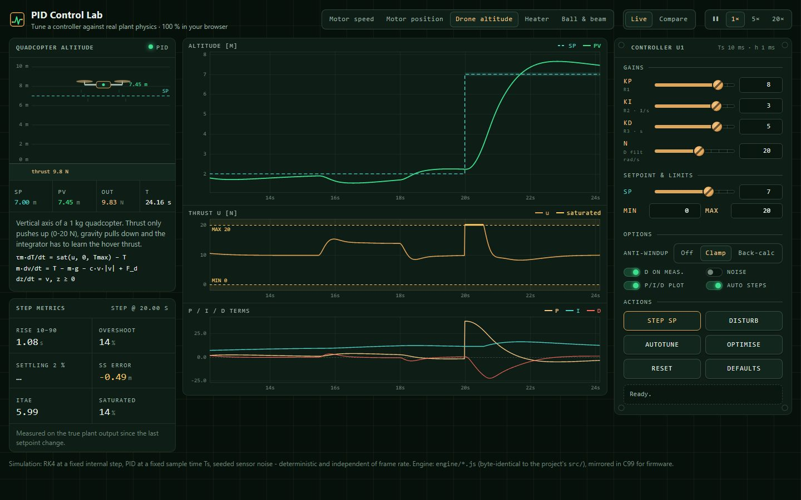
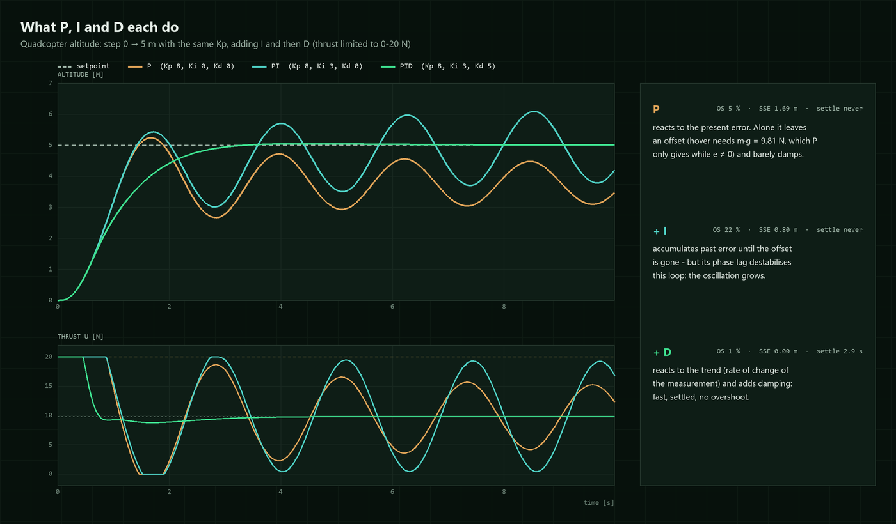
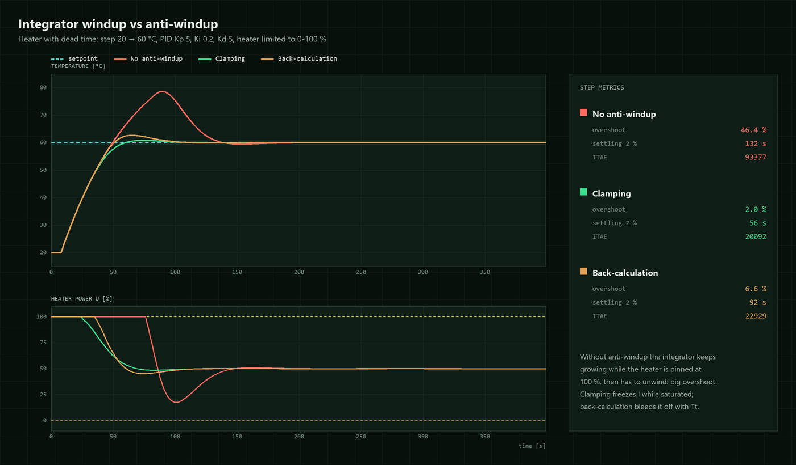
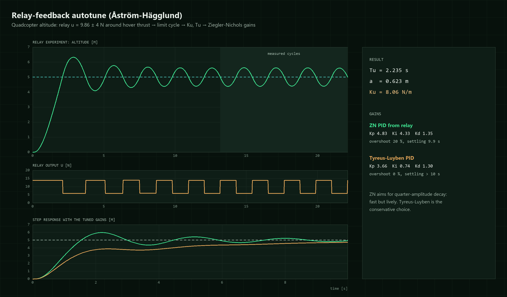

# PID Control Lab

A browser lab where you tune a PID controller against simulated physical plants in real time, and a C99 PID library for microcontrollers that is checked sample-for-sample against the same JavaScript reference.

**Live demo:** <https://aaron367123.github.io/demos/pid-lab/> (try `?plant=heater`, `?compare=1` or `?plant=drone&autoplay=1`)



- **Plants:** DC motor speed, DC motor position, quadcopter altitude, a heater with dead time, and ball on beam (unstable). All are continuous models integrated with RK4.
- **Controller:** discrete PID with anti-windup (clamping or back-calculation), derivative on measurement with a low-pass filter, output limits, setpoint weighting and bumpless gain changes.
- **Tuning:** relay-feedback autotune (Åström–Hägglund) with Ziegler–Nichols and Tyreus–Luyben rules, plus a Nelder–Mead optimiser.
- **Firmware:** `pid.c`/`pid.h` (C99, no malloc, no libm), with unit tests and a JS↔C golden-trajectory test. Built with `-Wall -Wextra -Wpedantic -Werror` (plus `-Wconversion -Wdouble-promotion`) and zero warnings. Includes Arduino and Pico examples.

```
pid-control-lab/
├── src/                 JS engine (ES modules, no dependencies, no DOM)
│   ├── pid.js           discrete PID controller (reference implementation)
│   ├── plants.js        plant models + RK4 integrator
│   ├── sim.js           closed-loop runner, seeded noise, quantisation, rate limit
│   ├── metrics.js       rise/overshoot/settling/SSE/IAE/ISE/ITAE/effort/saturation
│   ├── tuning.js        relay autotune, tuning rules, Nelder–Mead optimiser
│   └── index.js         barrel export
├── test/                node --test suites (35 tests)
├── firmware/
│   ├── pid.h, pid.c     C99 controller mirroring src/pid.js
│   ├── tests/test_pid.c unit tests + golden parity test
│   ├── tests/golden/    reference trajectories exported from JS
│   ├── examples/        Arduino sketch + Raspberry Pi Pico skeleton (untested on hardware)
│   └── Makefile
├── scripts/             golden export, figure data + Pillow figures, metrics table, demo sync
└── docs/                README figures
```

The web demo lives in the portfolio repo under `demos/pid-lab/`. Its `engine/` folder is a **byte-identical** copy of `src/`. `npm run sync-demo` copies it and a test fails if the two drift apart.

---

## Run, test, build

```bash
npm test                     # 35 JS tests (node >= 20, no npm install needed)
npm run golden               # regenerate firmware/tests/golden/*.csv from the JS controller
npm run metrics              # print the metrics tables below
npm run figures              # re-export figure data and redraw docs/*.png (needs Pillow)

cd firmware
make test                    # unit tests + golden parity, float build
make test-double             # same with pid_real_t = double
```

To run the demo locally, serve the portfolio root over HTTP (ES modules don't load from `file://`):

```bash
python -m http.server 5613 --directory <portfolio root>
# http://localhost:5613/demos/pid-lab/index.html?plant=drone&autoplay=1
```

### Windows build notes

The WinLibs GCC 16.2 build (installed with winget) can't link from a path that contains a space, such as `C:\Users\Aaron Jara\...`. Point it at the 8.3 short path before building:

```bash
# Git Bash
export GCC_EXEC_PREFIX=C:/Users/AARONJ~1/AppData/Local/MICROS~1/WinGet/Packages/BRECHT~1.SOU/mingw64/lib/gcc/
export PATH=/c/Users/AARONJ~1/AppData/Local/MICROS~1/WinGet/Packages/BRECHT~1.SOU/mingw64/bin:$PATH
cd firmware && mingw32-make test
```

```powershell
# PowerShell
$env:GCC_EXEC_PREFIX = 'C:/Users/AARONJ~1/AppData/Local/MICROS~1/WinGet/Packages/BRECHT~1.SOU/mingw64/lib/gcc/'
$env:PATH = 'C:\Users\AARONJ~1\AppData\Local\MICROS~1\WinGet\Packages\BRECHT~1.SOU\mingw64\bin;' + $env:PATH
mingw32-make -C firmware test
```

`mingw32-make` is in the same `bin` folder. The Makefile uses `gcc` (make's built-in `cc` doesn't exist in WinLibs) and adds `.exe` automatically when `OS=Windows_NT`. To find your own short path, run `cmd /c for %I in ("<long path>") do @echo %~sI`.

---

## PID in plain language

A feedback controller looks at the **error** `e = r − y` (setpoint minus measurement) and decides the actuator command `u`. PID adds three reactions together:

| Term | Reacts to | What it buys you | What it costs |
| --- | --- | --- | --- |
| **P** = Kp·e | the present error | fast response, stiffness | alone it leaves an offset when the plant needs a non-zero input to hold the setpoint; high Kp rings |
| **I** = Ki·∫e dt | the accumulated past error | zero steady-state error (it keeps pushing until e = 0) | phase lag → overshoot/oscillation; winds up when the actuator saturates |
| **D** = Kd·de/dt | the trend (rate of change) | damping: brakes before overshooting | amplifies sensor noise; kicks on setpoint steps if applied to e |



The drone shows all three clearly. With **P only**, hovering needs 9.81 N of thrust, and P can only produce that while there is an error, so the drone settles about 1.2 m low. Gravity is fought by proportional action alone and only drag damps it, so it also rings. **Adding I** removes the offset, but its extra phase lag destabilises this lightly damped loop. **Adding D** damps it: 0.9 % overshoot, settled in 2.9 s. The same experiment is one click away in the demo (Compare → P / PI / PID presets).

Drone, standard step 0 → 5 m (noise-free, `npm run metrics`):

| Controller | Kp / Ki / Kd | Rise | Overshoot | Settling (2 %) | SSE | ITAE |
| --- | --- | --- | --- | --- | --- | --- |
| P | 8 / 0 / 0 | 0.885 s | 4.8 % | never | 1.7 m | 64 |
| PI | 8 / 3 / 0 | 0.877 s | 22 % | never (growing) | 0.8 m | 41 |
| PID | 8 / 3 / 5 | 1.69 s | 0.87 % | 2.85 s | −0.004 m | 5.02 |

---

## Discretisation choices

The controller runs at a fixed sample time `Ts`, like a timer interrupt on a microcontroller. Each sample `k`:

```
e[k]   = r[k] − y[k]
P[k]   = Kp · (b·r[k] − y[k])                       setpoint weight b (1 = classic)
D[k]   = a·D[k−1] + Kd/(Tf+Ts) · (ed[k] − ed[k−1])   ed = c·r − y, a = Tf/(Tf+Ts)
v[k]   = P[k] + I[k] + D[k]                         unsaturated output
u[k]   = clamp(v[k], uMin, uMax)                    what the actuator gets
I[k+1] = I[k] + Ki·Ts·e[k]  (+ anti-windup term)
```

- **Derivative on measurement (c = 0).** A setpoint step makes `de/dt` infinite for one sample, the "derivative kick" that slams the actuator. The plant's output can't jump, so differentiating `−y` instead of `e` gives the same damping with no kick. On the heater, derivative on error produces an 80 % kick on a 40 °C step, while derivative on measurement produces exactly 0 (tested).
- **First-order filter on D (Tf = 1/N).** A pure derivative amplifies high-frequency noise without limit. `Kd·s/(Tf·s + 1)` behaves like a derivative below N rad/s and flattens above it. It is discretised with **backward Euler**, which is stable for any `Tf ≥ 0` (forward Euler goes unstable when `Tf < Ts/2`).
- **Integral stored in output units.** `I` already contains `Ki`, so changing `Ki` at runtime never makes the output jump. Changing `Kp`, `Kd` or `b` would make it jump, so `setGains()` moves the difference into the integrator (**bumpless transfer**).
- **Forward Euler for I.** `u[k]` uses `I[k]` (errors up to `k−1`), so the update order is simply "compute output, then update state". That is the same order in JS and C, which makes the golden test exact.
- **No spike on the first sample.** After `reset()`, `ed[k−1]` is initialised to the current value, so D starts at 0.

### Anti-windup compared

When the actuator saturates (heater at 100 %, thrust at 20 N), the error stays large and a naive integrator keeps growing. The output only comes back once the integral has "unwound", which causes a large overshoot.



| Method | Rule while saturated | Heater 20 → 60 °C |
| --- | --- | --- |
| none | `I += Ki·Ts·e` | 46 % overshoot, settles in 132 s |
| **clamping** (conditional integration) | skip the update if `v > uMax and e > 0` (or `v < uMin and e < 0`) | 2 % overshoot, 56 s |
| **back-calculation** | `I += Ki·Ts·e + (Ts/Tt)·(u − v)`, `Tt = max(Ts, Ti/2)` | 6.6 % overshoot, 92 s |

Clamping is the default: it is simple, has no extra parameter, and integration resumes as soon as the error changes sign. Back-calculation is smoother when the output saturates only briefly, but it needs a tracking time `Tt`. `Ti/2` equals the textbook `√(Ti·Td)` for ZN-style `Td = Ti/4` and needs no `sqrt` on the MCU.

---

## Plants

All plants are continuous ODEs integrated with **classic RK4** at an internal step `h` that is independent of the controller's `Ts`. The input is held constant between samples (zero-order hold, like a PWM register). An RK4 step on a first-order lag matches the analytic `K(1 − e^{−t/τ})` to better than 1e-6, and halving `h` cuts the error about 16× (4th order). Both are tested.

| Plant | Equations | Input / output | Ts / h | Defaults |
| --- | --- | --- | --- | --- |
| **DC motor speed** | `L di/dt = V − R i − Ke ω`<br>`J dω/dt = Kt i − B ω − τ_load` | ±12 V → rad/s | 5 ms / 0.5 ms | R 2 Ω, L 10 mH, Kt = Ke 0.05, J 2e-4 kg·m², B 1e-5; ω/V = 19.8 rad/s/V, τe 5 ms, τm 0.16 s |
| **DC motor position** | as above + `dθ/dt = ω` | ±12 V → rad | 5 ms / 0.5 ms | 4096-count encoder quantisation when noise is on |
| **Quadcopter altitude** | `τm dT/dt = sat(u,0,Tmax) − T`<br>`m dv/dt = T − m g − c v|v| + F_d`, `z ≥ 0` | 0–20 N → m | 10 ms / 1 ms | m 1 kg, c 0.3 kg/m, rotor lag 50 ms; thrust can't go negative |
| **Heater (FOPDT)** | `τ dT/dt = −(T − T_amb − d) + K·sat(P(t−L), 0, 100)` | 0–100 % → °C | 0.5 s / 10 ms | τ 60 s, K 0.8 °C/%, **dead time L 8 s**, heat-only; 1/16 °C sensor |
| **Ball on beam** | `τs dα/dt = sat(u) − α`<br>`dv/dt = (5/7) g sin α − f v`, `|x| ≤ 0.5` | ±0.25 rad → m | 10 ms / 1 ms | double integrator: unstable without D |

Each plant defines units, setpoint range, default gains, P/PI/PID presets, a disturbance (load torque, down-draft, ambient drop, push), sensor noise σ and quantisation. `sim.js` adds seeded Gaussian noise (mulberry32 + Box–Muller), sensor quantisation, an optional actuator slew limit, and setpoint and disturbance schedules. A run is a pure function of its inputs, so stepping it in uneven chunks gives exactly the same trajectory (tested). That is why the demo is deterministic regardless of frame rate.

### Default gains (standard noise-free step from rest)

These bounds are asserted in `test/sim-metrics.test.js`.

| Plant | Step | Kp / Ki / Kd | Rise | Overshoot | Settling (2 %) | SSE | ITAE | Sat. time |
| --- | --- | --- | --- | --- | --- | --- | --- | --- |
| DC motor speed | 0 → 100 rad/s | 0.12 / 0.9 / 0 | 0.12 s | 0.75 % | 0.195 s | −0.007 rad/s | 0.374 | 1 % |
| DC motor position | 0 → π rad | 4 / 0.5 / 0.2 | 0.071 s | 0.95 % | 0.115 s | −0.016 rad | 0.0256 | 1 % |
| Quadcopter altitude | 0 → 5 m | 8 / 3 / 5 | 1.69 s | 0.87 % | 2.85 s | −0.004 m | 5.02 | 4.6 % |
| Heater | 20 → 60 °C | 5 / 0.2 / 5 | 35 s | 2 % | 56 s | 0 °C | 20092 | 6.1 % |
| Ball on beam | 0 → 0.25 m | 3 / 0.05 / 1.2 | 0.74 s | 0.42 % | 1.39 s | −0.001 m | 0.0598 | 5.8 % |

---

## Autotune



**Relay feedback (Åström & Hägglund, 1984).** Ziegler–Nichols tuning needs the *ultimate gain* `Ku` (the P gain at which the loop just oscillates) and the oscillation period `Tu`. Finding them by cranking Kp until the loop is marginally stable is risky on real hardware. Instead, temporarily replace the PID with an on/off relay `u = bias ± h` around the setpoint. Most plants then settle into a small, bounded limit cycle at exactly the frequency where their phase is −180°.

- `Tu` = period of the limit cycle (averaged over the last 4 of 8 cycles)
- `Ku = 4h / (π·a)`: the describing function of an ideal relay, with `a` = output amplitude. Hysteresis ε generalises it to `4h / (π·√(a² − ε²))`.
- The lab uses the **first-harmonic estimate** `Ku = |U1| / |Y1|` (Fourier coefficients of u and y over whole periods). The describing function assumes y is a sine. On dead-time plants the limit cycle is closer to a triangle, and the peak-based estimate comes out about 20 % low.
- `bias` is the operating-point input (hover thrust, holding power). It is re-centred during warm-up so on and off times are equal.

| Rule | Kp | Ti | Td |
| --- | --- | --- | --- |
| Ziegler–Nichols PID | 0.6 Ku | Tu/2 | Tu/8 |
| Ziegler–Nichols PI | 0.45 Ku | Tu/1.2 | – |
| Tyreus–Luyben PID | Ku/2.2 | 2.2 Tu | Tu/6.3 |
| Tyreus–Luyben PI | Ku/3.2 | 2.2 Tu | – |
| ZN "some overshoot" | 0.33 Ku | Tu/2 | Tu/3 |
| ZN "no overshoot" | 0.2 Ku | Tu/2 | Tu/3 |

The rules give `Ki = Kp/Ti` and `Kd = Kp·Td`.

**Accuracy (tested):**

| Plant | Ku (estimate vs analytic) | Tu (estimate vs analytic) |
| --- | --- | --- |
| `K/(τs+1)³`, analytic Ku = 8/K, Tu = 2πτ/√3 | −3.8 % (DF −3.0 %) | +1.7 % |
| Heater FOPDT, analytic from `Lω + atan(τω) = π` | −1.9 % (DF −20 %) | +1.8 % |

The remaining error is intrinsic to the method. The relay's harmonics shift the limit cycle slightly off the exact −180° frequency.

**Optimiser.** Nelder–Mead on `log10` of the non-zero gains (so the structure P/PI/PID is kept and gains stay positive), clamped to the plant's slider range. Each candidate is scored with a full step simulation that includes the plant's sensor noise (fixed seed), so the search can't win by cranking Kd:

```
J = ITAE/(|A|·T²) + wOs·(max(0, OS% − 2)/10)² + wSat·(saturated fraction) + wTv·Σ|Δu|/(uSpan·n)
```

It takes about 150 simulations, which is 0.1–1.5 s in the browser. The demo time-slices the search across animation frames.

---

## Metrics

Metrics are computed for one setpoint step from `y0` to `r`, with amplitude `A = r − y0`. They are sign-aware, so steps down work too.

| Metric | Definition |
| --- | --- |
| Rise time | t(90 % of A) − t(10 % of A), first crossings, linearly interpolated |
| Overshoot | max(0, max((y − r)/A)) × 100 % |
| Settling time | last time \|y − r\| > 2 % of \|A\| (∞ if still outside the band at the end of the window) |
| Steady-state error | r − mean(y) over the last 10 % of the window |
| IAE / ISE / ITAE | Σ\|e\|Ts, Σe²Ts, Σ t\|e\| Ts (t since the step) |
| Control effort | Σ\|u\|Ts and Σu²Ts; total variation Σ\|Δu\| |
| Saturation | % of samples with u at a limit |

These definitions are checked against analytic responses. For a first-order lag, rise = τ·ln 9, settling = τ·ln 50, IAE = τ and ITAE = τ². For a 2nd-order response, overshoot = exp(−ζπ/√(1−ζ²)). The demo computes them live on the true (noise-free) plant output since the last setpoint change.

---

## JS ↔ C parity

`scripts/golden.js` runs three scripted closed-loop scenarios in JS:

- drone with clamping, noise and a mid-run gain change
- motor with back-calculation, b = 0.7, saturating steps, a load step and a reset
- heater with no anti-windup, derivative on error and a quantised sensor

For every sample it records the inputs (sp, y, gains, reset flag) and the JS outputs (u, P, I, D) as CSV. `test_pid.c` replays the inputs through `pid.c` and requires **u, I and D to match within 1e-4** on all 1300 samples.

| Golden file | Samples | max \|C − JS\| (float) | (double) |
| --- | --- | --- | --- |
| drone_clamp | 600 | 2.8e-5 | 5.5e-7 |
| motor_backcalc | 400 | 5.9e-6 | 1.7e-7 |
| heater_none | 300 | 5.0e-5 | 4.9e-8 |

The float error is single-precision rounding on values up to about 130 (the wound-up heater integrator). The double error is limited by the 9-significant-digit CSV. `test/parity.test.js` fails if the committed CSVs no longer match the current JS, so the C test always compares against the live reference.

### Using the C library

```c
#include "pid.h"

static pid_ctrl_t pid;

void control_init(void) {
    pid_config_t cfg;
    pid_default_config(&cfg);
    cfg.kp = 0.12f; cfg.ki = 0.9f; cfg.kd = 0.0f;
    cfg.ts = 0.005f;                 /* must match the timer period */
    cfg.tf = 0.01f;                  /* derivative filter, Tf = 1/N */
    cfg.out_min = -12.0f; cfg.out_max = 12.0f;
    cfg.aw = PID_AW_CLAMP;
    pid_init(&pid, &cfg);
}

void timer_isr_5ms(void) {
    float u = pid_update(&pid, setpoint, read_speed());
    set_pwm_volts(u);
}
```

`pid_set_gains()` is bumpless and `pid_reset()` clears the state. `pid.p/.i/.d/.u/.sat` hold the last sample for telemetry. There is no dynamic memory and no libm; an update is a few dozen float operations and one branch per anti-windup check.

**Examples (untested on hardware):**

- `firmware/examples/arduino_motor_speed/`: Uno/Nano with Timer1 CTC at 200 Hz, encoder on INT0, PWM + DIR to an H-bridge, serial telemetry. Copy `pid.c`/`pid.h` next to the `.ino`.
- `firmware/examples/pico_motor_speed/`: RP2040 with `add_repeating_timer_us` at 5 ms, 20 kHz PWM, GPIO IRQ encoder, Pico SDK CMake skeleton.

Neither has been compiled for or run on a board. They show the structure (fixed-rate ISR or timer callback, speed from encoder counts per sample, PID output → PWM duty), not a validated driver.

---

## The demo

The UI is static HTML, CSS and ES modules with no CDN and no build step. A `requestAnimationFrame` loop feeds a **fixed-step accumulator**: wall-clock time × speed is converted into whole controller samples, so 1×, 5× and 20× (and a slow laptop) all produce the same trajectory.

**URL parameters:**

| Parameter | Effect |
| --- | --- |
| `plant=motor-speed\|motor-position\|drone\|heater\|ball-beam` | select the plant |
| `kp=&ki=&kd=&n=` | preset gains |
| `autoplay=1` | cycle setpoints and disturbance pulses automatically |
| `compare=1` | open the Compare view with the P / PI / PID overlay |
| `theme=light\|dark` | colour theme (otherwise follows `prefers-color-scheme`) |
| `prerun=<s>` | simulate that much time before the first paint (deterministic, for screenshots and embeds) |
| `autotune=1` | start the relay experiment immediately |
| `speed=0\|1\|5\|20`, `noise=1`, `terms=0` | simulation speed, sensor noise, hide the P/I/D plot |

---

## Limitations

- **The models are textbook-simple.** The motor has no Coulomb friction, cogging or current limit. The drone is a 1-D vertical axis. The heater is a single lump with a pure delay. Real plants have more dynamics, and gains from the lab are a starting point, not a final answer.
- **Relay autotune is approximate.** It is −2 to −4 % on Ku in the tested cases. On fast, nearly first- or second-order plants (the motor speed loop), the limit cycle is set mostly by the sample delay (Tu ≈ 6 samples), so ZN gains come out aggressive and amplify noise. Tyreus–Luyben or the optimiser are better there. ZN on integrating plants (motor position) overshoots heavily (about 75 %), as the literature warns.
- **The optimiser is local.** Nelder–Mead finds a nearby minimum of a hand-weighted cost. Different weights give different "optimal" gains.
- **Clamping and back-calculation assume `Ki ≥ 0`**, and the rate limiter sits after the PID, so a slew-limited actuator still winds up a little. Feeding the applied output back to the PID (tracking) would fix that.
- **The C examples have not been run on hardware.** The library itself is host-tested only (GCC 16, x86-64), in float and double.
- **Float parity is tested to 1e-4 absolute** for signals up to about 130. Much larger magnitudes would need a relative tolerance.

## License

MIT © 2026 Aaron Morris Jara. See [LICENSE](LICENSE).
